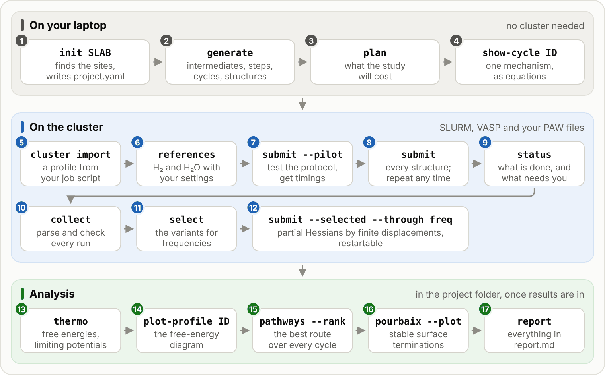
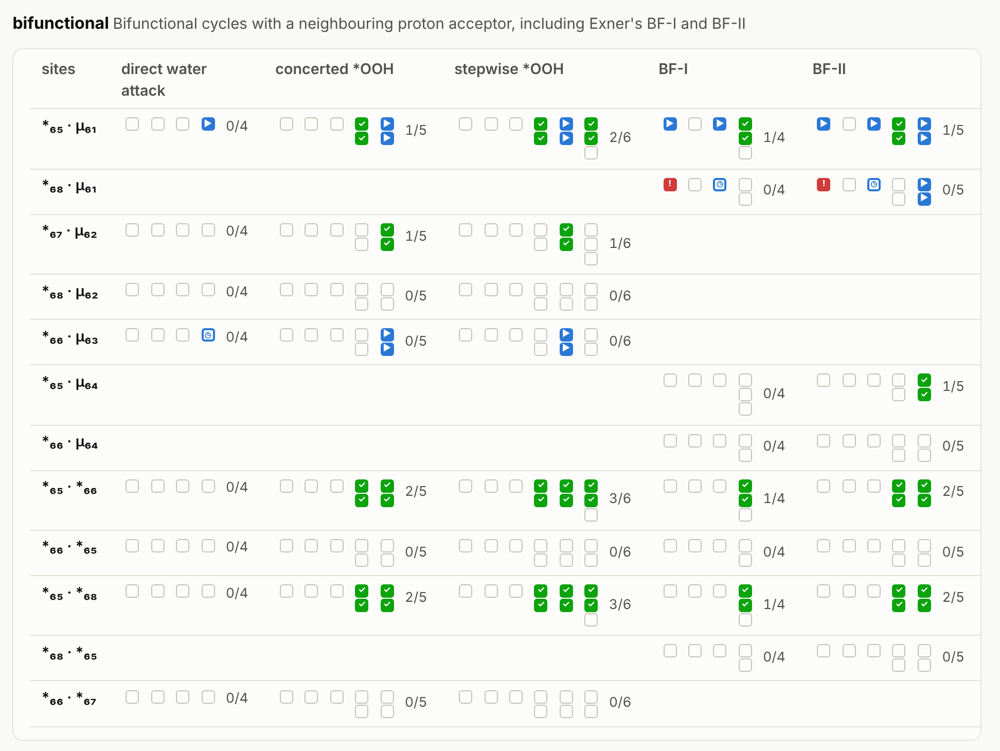

# mechanet

**Reaction networks for electrocatalysis on surfaces, from the slab file to free energies.**

mechanet takes a slab, finds its reactive sites, builds the network of intermediates, steps
and catalytic cycles that the literature proposes for a reaction (oxygen evolution and
chlorine evolution are built in), writes clash-free starting structures for every
intermediate, runs them through a staged VASP protocol on any SLURM cluster (restartable,
with partial-Hessian frequencies), and analyses the results with the computational hydrogen
electrode: limiting potentials, Exner's Gmax(U), resting states, the route of lowest
overpotential over *every* cycle of the network whose steps have computed energies, and
surface Pourbaix diagrams.



- [Install](#install)
- [Quick start](#quick-start)
- [A study step by step](#a-study-step-by-step)
- [Running on your cluster](#running-on-your-cluster)
- [Following a campaign](#following-a-campaign)
- [Reactions and mechanism families](#reactions-and-mechanism-families)
- [Finding new pathways](#finding-new-pathways)
- [Magnetic moments along a cycle](#magnetic-moments-along-a-cycle)
- [Surface Pourbaix diagrams](#surface-pourbaix-diagrams)
- [Extending mechanet](#extending-mechanet)
- [Examples](#examples)
- [Scope and limitations](#scope-and-limitations)

**Documentation: [mechanet.readthedocs.io](https://mechanet.readthedocs.io)**, with
[getting started](https://mechanet.readthedocs.io/en/latest/getting-started.html), five [tutorials](https://mechanet.readthedocs.io/en/latest/tutorials/index.html)
from a first network on a laptop to free energies, [following a campaign](https://mechanet.readthedocs.io/en/latest/following-a-campaign.html),
[checking results](https://mechanet.readthedocs.io/en/latest/checking-results.html),
the [project.yaml reference](https://mechanet.readthedocs.io/en/latest/project-file.html) (every setting),
[execution](https://mechanet.readthedocs.io/en/latest/execution.html) (stages, continuation, SLURM),
[what mechanet computes](https://mechanet.readthedocs.io/en/latest/science.html) (and how to read it),
[plugins](https://mechanet.readthedocs.io/en/latest/plugins.html) (new reactions, adsorbates and mechanisms)
and a [reference of every command](https://mechanet.readthedocs.io/en/latest/commands.html).

## Install

```bash
pip install mechanet              # Python >= 3.10; numpy, ase, spglib, networkx, pyyaml
pip install "mechanet[plots]"     # adds matplotlib for profiles and Pourbaix figures
# until mechanet is on PyPI, from the repository (a tag pins the version):
pip install "mechanet[plots] @ git+https://github.com/dhernandezcastillo/mechanet.git@v0.1.3"
```

Install it on the cluster, in an environment the compute nodes can see (for example a
virtual environment on a shared file system): each job runs `python -m mechanet run-state ...`
with the Python that ran `mechanet submit`, unless the cluster profile sets `python:` (or the
job's environment sets `MECHANET_PYTHON`). VASP and its PAW datasets are not part of mechanet;
you need a licensed VASP installation.

## Quick start

```bash
mechanet cluster import my_vasp_job.sh --name hpc     # once per cluster: a job script that runs VASP there
mechanet examples RuO2_110                            # an example slab (or use your own slab file)
mechanet init RuO2_110.vasp ruo2 --cluster hpc        # inspect, answer a few questions -> ruo2/project.yaml
cd ruo2
mechanet generate                                     # 63 intermediates, 146 steps, 100 cycles, 69 starts
mechanet plan                                         # what it will cost
mechanet submit --pilot                               # preview the first jobs; add --execute to submit
```

`init` writes `slab/site_map.html`, a static page showing the sites it found; open it
before generating. Every value `init` detected is marked `[auto]` in `project.yaml`.

## A study step by step

| Step | Command | What happens |
|---|---|---|
| 1 | `mechanet init SLAB` | Finds the vacuum axis, active side, fixed region, reactive sites (O/OH/H2O ligands, open metal sites), symmetry and site pairs; proposes the partial-Hessian region, PAW datasets, starting moments and (for oxides) Materials Project U values; writes the project, INCAR templates, KPOINTS, a references template and the site map. Your own choices go in at once with `--dft-u Fe=5.3,Ni=6.2` (or `none`), `--potcar-variants Fe=Fe_pv,...` and `--potcar-dir DIR`. |
| 2 | `mechanet generate` | Builds the network from the mechanism families in `scope.families`, places every adsorbate with a scored clash-free search, merges lattice-translation images, and writes one starting structure per variant into `campaign/states/`. No DFT. |
| 3 | `mechanet plan` / `cycles` / `show-cycle` | Counts nodes, cycles, starts, DFT runs and displacement single points (node-hours once pilot timings exist); writes the method card. |
| 4 | `mechanet submit --pilot --execute` | The reference, one start per adsorbate type and the most crowded start: checks the protocol and gives timings. |
| 5 | `mechanet submit --execute` | All states through `02_final` (repeat the command to continue jobs stopped at the walltime; `--max-active N --refill` keeps N jobs running). `mechanet status` shows what is finished, running, queued or waiting, per state and per cycle. |
| 6 | `mechanet collect`, `review`, then `select` | Parses results (convergence, forces, moments, topology) and assigns relaxed structures to the intermediates they became. `review` lists the finished structures that changed during the relaxation (which H moved where, which bond broke, the cycles they hold up) and records your decisions. `select` picks the variants that continue to frequencies (`--families aem,...` or `--cycles` to restrict them); variants that relaxed into the same minimum are merged first, and variants of one intermediate that converged to different magnetic solutions are reported. |
| 7 | `mechanet submit --selected --through freq --execute` | `04_static` and the partial Hessian by restartable finite displacements. |
| 8 | `mechanet thermo` | Free energies of every intermediate, step and cycle at the analysis potentials; Gmax(U), limiting potential, overpotential, resting states; the local moments of the active-site atoms along each cycle, with a spin check. `--electronic-only` gives a screening estimate before frequencies exist. `mechanet plot-profile CYCLE --potential U` draws the profile with the moments underneath. |
| 9 | `mechanet pathways --rank` | Every balanced cycle of the network, curated or not, ranked per reaction with the project's references; the lowest limiting potential over all cycles, of any length, whose steps have energies. |
| 10 | `mechanet pourbaix --plot` | The most stable computed termination over pH and potential. |
| 11 | `mechanet report` | `report.md` with the network, progress and every analysis so far. |

Every command prints a readable summary, or JSON with `--json`. Nothing is ever submitted
without `--execute`. Commands find the project and its campaign themselves when run inside
the project folder or any folder below it.

Molecular references (H2, H2O, and Cl2 for CER) must be computed with your slab's settings:
`mechanet references --molecules refs/` writes ready-to-run inputs derived from your
INCAR_final, and `mechanet references --collect refs/` reads E0 and the ideal-gas
correction back into `inputs/references.yaml`. mechanet never substitutes literature values.

## Running on your cluster

mechanet works on any SLURM cluster. What differs between clusters lives in a *cluster
profile*, `~/.config/mechanet/clusters/<name>.yaml`, written once from a job script that
already runs VASP there:

```bash
mechanet cluster import vasp_job.sh --name hpc   # #SBATCH options, environment lines and the VASP launch line
mechanet cluster show hpc                         # validates it and prints the job script it produces
```

```yaml
mechanet_cluster: 1
name: hpc
sbatch: {nodes: 1, ntasks-per-node: 112, time: "23:59:00", partition: standard, account: my_project}
setup:                                                   # run verbatim, in this order, before VASP
- module load vasp/6.4.1
- export OMP_NUM_THREADS=1
- source ~/venvs/mechanet/bin/activate
vasp_command: [mpirun, -n, "$SLURM_NTASKS", vasp_std]   # $VAR, ${VAR}, ${VAR:-default} expanded in the job
max_active_jobs: 20
potcar_dir: /path/to/potpaw_PBE                          # optional: your licensed PAW library
```

Personal and per-submission options (`--mail-user`, `--job-name`, output files, `--begin`,
`--dependency`) are never copied from the imported script; `module`, `source`, `export`,
`conda` and similar lines are kept verbatim and in order, and redirections or a trailing `&`
are dropped from the VASP launch line (the runner writes `vasp.out` itself). Each job runs one
state's stages; `#SBATCH --signal=B:USR1@1800` (a quarter of the walltime for jobs shorter than
2 h) lets the runner stop VASP cleanly before the time limit, and running the same `submit`
again continues. A stage that needs more time than a job has (`min_remaining_s`) starts at
the beginning of the next job.
With `--refill`, a job that SLURM kills at its hard time limit (a stage that overran the stop
signal) is continued by a new job, like one that stopped cleanly; a job you cancel is not
replaced.
See [docs/execution.md](https://github.com/dhernandezcastillo/mechanet/blob/main/docs/execution.md) for continuation, retries, the job cap, refill
from compute or login nodes, and cleanup.

The PAW library can come from the profile (`potcar_dir`) or from the project
(`mechanet init ... --potcar-dir DIR`, or `vasp.potcar_dir` in project.yaml).

## Following a campaign

```bash
mechanet status                     # what is finished, running, queued, waiting; per state and per cycle
mechanet status --cycles            # every cycle, one mark per intermediate
mechanet status --list todo         # state IDs a submit would start (or: running, queued, attention, ...)
mechanet show-cycle bifunctional_a0065_a0061_BF2
```

`status` reads the run records, the submission ledger and one `squeue` listing of your jobs
(`--no-slurm` skips it); nothing is submitted or changed. Each state is measured against the
stage its last submission (or the refill) asked for, or `--through STAGE`, and lands in one
group: finished, running, queued, to continue (stopped part way; the next submit continues
it), needs you (a failed attempt waiting for `--retry`, a used-up budget, an unknown
submission) or not started. It also writes `campaign/status.html`, a self-contained page
(copy it to your computer and open it in a browser) with a grid of sites × mechanisms, one
square per structure, and every cycle's steps and structures:



[Following a campaign](https://mechanet.readthedocs.io/en/latest/following-a-campaign.html) explains the page, with an
interactive example.

Finished is not yet accepted: `collect` also checks that each relaxed structure is still the
intermediate it was built for. `mechanet review` lists those that changed, in plain words
("H p_a0065 moved from O d_a0065 to O a0066"), with the cycles they hold up, and records your
decision in `states/STATE/review.json` (`--accept STATE "why"`, `--assign STATE NODE "why"`);
`status` marks them with `?` once the campaign has been collected. See
[Checking results](https://mechanet.readthedocs.io/en/latest/checking-results.html).

Intermediates and steps are written in a compact notation, also used by `show-cycle`,
`report` and `plot-profile`:

```text
Bifunctional mechanism II (BF-II)
  Exner (Mater. Horiz. 2023) bifunctional mechanism II after Halck et al. 2014, ...
  sites: 65 = a0065: terminal O on Fe a0003 (native OH); 61 = a0061: O bridging Fe a0003 and Ni a0005 (native OH)
  1. *₆₅ · μ-O₆₁ + H₂O → *OH₆₅ · μ-O₆₁ + H⁺ + e⁻   electrochemical
  2. *OH₆₅ · μ-O₆₁ → *O₆₅ · μ-O₆₁ + H⁺ + e⁻        electrochemical
  3. *O₆₅ · μ-O₆₁ + H₂O → *OOH₆₅ · μ-OH₆₁          chemical
  4. *OOH₆₅ · μ-OH₆₁ → *OOH₆₅ · μ-O₆₁ + H⁺ + e⁻    electrochemical
  5. *OOH₆₅ · μ-O₆₁ → *₆₅ · μ-O₆₁ + O₂ + H⁺ + e⁻   electrochemical
```

`*` is a terminal site (a terminal ligand or an open metal site; `*₆₅` alone is the bare
metal), `μ-` a bridging one (`μ-□` a bridge vacancy), the subscript the site number (a0065 →
65), and `·` separates the sites of one intermediate. Steps are listed with the one that
releases the product last. Terminals that cannot show subscripts get an ASCII form
(`*OOH65 & mu-O61 -> ...`).

## Reactions and mechanism families

| Reaction | Net (one turnover) | Potential scale | Core families |
|---|---|---|---|
| `oer` | 2 H2O → O2 + 4 (H⁺ + e⁻) | RHE | `aem`, `surface_bridge`, `pair_coupling`, `terminal_bridge_coupling`, `bifunctional`, `hydrated` |
| `cer` | 2 Cl⁻ → Cl2 + 2 e⁻ | SHE | `cer_volmer_heyrovsky`, `cer_ocl` |

| Family | Proposes |
|---|---|
| `aem` | Adsorbate evolution (\*OH, \*O, \*OOH, \*OO) on terminal ligands and open metal sites |
| `surface_bridge` | Oxidation, O2 release and refill of bridging O |
| `pair_coupling`, `terminal_bridge_coupling` | O–O coupling between neighbouring sites, every ordering of the refill steps |
| `bifunctional` | Proton transfer to a neighbouring acceptor, Exner's BF-I and BF-II |
| `hydrated` | Bound-water refill and local proton relays |
| `oo_oo` | O4 recombination on terminal pairs (separate transition-state seeds) |
| `cer_volmer_heyrovsky`, `cer_volmer_tafel`, `cer_ocl` | Cl adsorption and release, Tafel recombination, the OCl route on O-covered sites |
| `coverage` | Terminations only (no cycles), for surface Pourbaix diagrams |
| `enumerated` | Every occupancy of one to three chosen sites, every elementary step and every balanced cycle between them |

`mechanet plugins` lists everything installed, including third-party plugins. Every edge
carries a reservoir vector (for example `{H2O: -1, H+: 1}` for \*O + H2O → \*OOH + H⁺ + e⁻)
and every cycle is checked to sum to exactly one turnover.

## Finding new pathways

The families write the cycles the literature proposes. `mechanet pathways` treats the
network as a directed graph (networkx) and finds the cycles nobody wrote down:

1. it proposes every *elementary* step between existing intermediates: local (one site, or
   a site pair), at most one heavy-atom change, and a reservoir vector that is one of the
   reaction's elementary steps (one PCET, water attack, an O2 release, ...);
2. it enumerates every balanced cycle up to `--max-length` steps (default 6) touching at
   most `--max-sites` sites (default 2), grouped into lattice-translation classes;
3. with energies (`--rank`, with the project's references file or `--references FILE`) it evaluates
   every cycle at each potential, ranked per reaction, and finds the **lowest limiting
   potential over all cycles of any length whose steps have energies** exactly, with a
   potential sweep over a bottleneck-path search instead of enumeration, after the
   minimum-overpotential search of Govind Rajan and Carter (J. Phys. Chem. C 2020).

No new DFT is needed: discovered cycles reuse the computed intermediates.
`mechanet pathways --adopt ID ...` (or `--adopt best` with `--rank`) copies discovered
cycles into `network.json`, so `thermo` and `plot-profile` treat them like curated ones. To
also discover new *intermediates*, use the `enumerated` family at generation time.

On RuO2(110) with the core families, every one of the 100 curated cycles is recovered and
6,198 further balanced cycles of up to six steps are found (3,099 symmetry-unique).

## Magnetic moments along a cycle

`thermo` follows the projected local moments (VASP with LORBIT) of the structures the energies
come from, atom by atom through each cycle:

* the moments of the active-site atoms (the site metal, the bound atom, the outer atom of
  *OOH) and of the atoms whose moment changes most, per intermediate:
  `analysis/cycle_moments.csv`, `mechanet show-cycle ID`, the report, and a panel under the
  free-energy profile of `mechanet plot-profile` (leave it out with `--no-moments`);
* a **spin check**: between consecutive intermediates, a moment that changes sign, or a
  moment farther than `analysis.moment_site_radius_A` (3.6 Å) from the site metals that
  changes by more than `analysis.moment_change_muB` (0.5 μB), is flagged. A flagged step
  compares intermediates whose spectator atoms (subsurface, bulk, a remote metal) are in
  different magnetic solutions, and its ΔG contains that difference. `cycles.csv` and the
  pathway ranking carry the result per cycle;
* variants of one intermediate that converged to different magnetic solutions, with their
  energy gap (`select` and `thermo`).

Moments are not oxidation states, and a consistent cycle does not prove the magnetic ground
state.

## Surface Pourbaix diagrams

```bash
mechanet pourbaix --plot                       # SHE scale, pH 0-14, U -0.5 to 2.5 V
mechanet pourbaix --scale RHE --at-pH 0,13     # exact transitions at chosen pH values
```

Every computed termination forms from the reference surface and the reaction's formation
species; its CHE formation free energy is linear in U and pH, so the stable regions are
exact convex polygons (written to `pourbaix/pourbaix.json`) and the transitions at a given
pH are exact. Add the `coverage` family to the scope to compute terminations for this
purpose. Only computed terminations can appear.

## Extending mechanet

Reactions, adsorbates, mechanism families and CLI commands are plugins, registered through
the entry-point groups `mechanet.reactions`, `mechanet.adsorbates`, `mechanet.families` and
`mechanet.commands`, or loaded from a local file listed under `plugins:` in project.yaml
(`mechanet init SLAB --plugin FILE --reaction NAME` starts a project for a plugin reaction).
The built-in OER and CER chemistry is registered the same way. A two-step family fits in a
dozen lines; see [docs/plugins.md](https://github.com/dhernandezcastillo/mechanet/blob/main/docs/plugins.md).

## Examples

| Folder | System | Reaction, scope |
|---|---|---|
| `examples/ruo2_110` | RuO2(110), 2×1, bridging O and CUS Ru | OER, core families |
| `examples/iro2_110` | IrO2(110), 2×1 | OER, core families |
| `examples/pt_111` | Pt(111), 3×3×4 | OER, adsorbate evolution |
| `examples/ruo2_110_cer` | RuO2(110) | CER, core families |
| `examples/nife_ldh` | NiFe LDH edge (90 atoms, skewed cell, interlayer water) | OER, core families, with a reference build checked by the tests |

The example folders are in the source distribution and the [repository](https://github.com/dhernandezcastillo/mechanet/tree/main/examples); the three slabs
(`RuO2_110`, `IrO2_110`, `Pt_111`) also come with the package: `mechanet examples NAME` writes
one to start a project from. `examples/build_slabs.py` rebuilds the oxide and metal slabs
(pymatgen, ASE) from experimental lattice constants; relax the bulk with your functional
before production. Each example has a `project.yaml`; set `cluster:` and run
`mechanet generate` in it.

## Scope and limitations

mechanet computes thermodynamics under the computational hydrogen electrode: free energies
of proposed intermediates and the descriptors derived from them. It does not compute
activation barriers, rates, constant-potential or explicit-field energetics, and a
favourable descriptor does not establish a mechanism. Every edge stays *proposed* until
someone investigates the path. Placements and explicit-water arrangements are sampled, not
exhausted; magnetic states are not sampled: every structure starts from the same MAGMOM, and
mechanet only reports when intermediates or variants ended in different magnetic solutions.
On metal surfaces adsorbates are placed on top sites only (one open site per surface metal);
bridge and hollow sites are not generated yet, so a metal's preference for them is missed.
Partial Hessians neglect vibrations of the frozen region. The
execution layer drives VASP; other codes would need a calculator plugin (not yet available).
[docs/science.md](https://github.com/dhernandezcastillo/mechanet/blob/main/docs/science.md) states what each number means.

## Citing

If mechanet helps your work, please cite the software (see [CITATION.cff](https://github.com/dhernandezcastillo/mechanet/blob/main/CITATION.cff)) and the papers
behind the mechanisms and descriptors you use: `mechanet plugins` and every
`network.json` record their literature keys, and `mechanet.literature.LITERATURE` holds the
full references.

## License

MIT. See [LICENSE](https://github.com/dhernandezcastillo/mechanet/blob/main/LICENSE).
