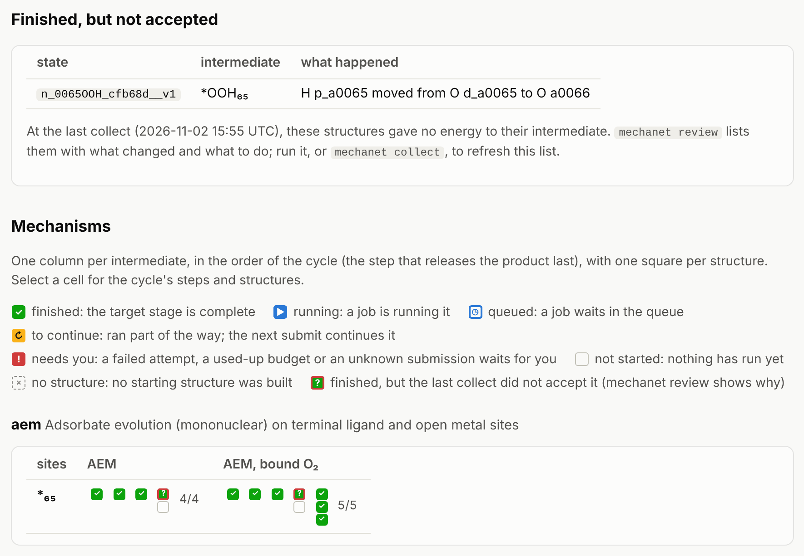

# Checking results: `mechanet review`

A structure counts as *finished* when its 02_final relaxation ran to the end and the runner
accepted the run. Its energy only enters the analysis once `collect` also accepts it:

- **its files** are still the ones the runner accepted, and its inputs those it ran with;
- **the relaxation converged**: electronically, and with every movable atom below the EDIFFG
  force criterion;
- **the relaxed structure is still the intermediate it was built for.** `collect` compares its
  bonds with the starting structure: which H sits on which O, whether O–O bonds survived, and
  which O atoms are bound to which metal.

On real surfaces the third check is the one that matters. A proton hops to a neighbouring O,
an OOH gives its H to a water molecule, an O₂ leaves the metal, a water molecule binds to an
open site. Such a structure is still a valid calculation, but no longer of the intermediate
it was meant to be, so its energy cannot be used for it. Three cases are settled without you:
a structure that relaxed into another intermediate of the campaign counts for that one; a
proton shared between two neighbouring O that moved to its other O, away from the sites the
intermediate changes, leaves the intermediate the same ([another tautomer](#shared-protons-tautomers));
and a molecule that left the surface means no bound minimum from that start
([below](#no-bound-minimum)).

## The command

```bash
mechanet review
```

It collects the campaign, then lists every finished structure that gives no energy to its own
intermediate, says in plain words what changed, which complete cycles that holds up, and what
to do:

```text
7 finished structures: 6 accepted for their intermediate, 1 not

Needs your review: the relaxed structure changed
  n_0065OOH_cfb68d__v1  *OOH₆₅
      H p_a0065 moved from O d_a0065 to O a0066
      outside the site model: the proton count on framework oxygen a0066 changed
      another start of *OOH₆₅: n_0065OOH_cfb68d__v2 (not run yet)

Cycles (2 symmetry-unique): 0 with an accepted structure for every intermediate
Held up (every intermediate finished, some without an accepted structure):
  aem_a0065_AEM  Adsorbate evolution (AEM)
      *OOH₆₅: needs review; 1 more start not finished
  aem_a0065_bound_OO  AEM with O₂ held on the site before it leaves
      *OOH₆₅: needs review; 1 more start not finished

What to do: look at each structure (states/STATE/02_final/CONTCAR), then
  mechanet review --accept STATE "why"         it is still its intermediate
  mechanet review --assign STATE NODE "why"    it is another intermediate of the same composition
  mechanet submit --states STATE --execute     run another start of the intermediate
and run mechanet thermo again: it reads the decisions.
```

Atoms are named by element and ID: `a0066` is the 66th atom of the slab file, and the atoms an
adsorbate adds carry the site they belong to (`d_a0065` is the outer O and `p_a0065` the H of
the OOH on site a0065). `collect` and `thermo` say how many finished structures were not
accepted, and `show-cycle` points here when an intermediate has no energy.

## The outcomes

| Outcome | What it means | What to do |
|---|---|---|
| Accepted | The structure is its intermediate; its energy is used | Nothing |
| Accepted in another tautomer | Only shared protons between two sites the intermediate leaves native moved; it is the same intermediate | Nothing; `thermo` checks the cycles (below) |
| Relaxed into another intermediate | Its bonds now describe another intermediate of the campaign, typically because a proton moved to a neighbouring site. Its energy counts for that one, where it competes with that intermediate's own structures | Nothing for the structure. The intended intermediate needs another start that stays intact, or this is the chemistry: the intermediate is not a minimum there |
| Needs your review | The bonds changed into something no intermediate of the campaign describes, or a bond to the metal changed | Look at the relaxed structure, then decide (below), or run another start |
| No bound minimum | A molecule (O₂, OOH, water) left the surface | Nothing to decide (below) |
| Rejected | Files changed after the run, or convergence or forces fail | Read the reasons; a run whose OUTCAR or CONTCAR changed afterwards has to be restored or run again |

## Deciding

Look at the relaxed structure (`states/STATE/02_final/CONTCAR`) next to its starting
structure (`states/STATE/POSCAR`). Then:

- **It is still the intended intermediate.** For example, a proton moved between two
  oxygens of the slab that are not reactive sites, three ångström from the site, and nothing
  at the site itself changed. Accept it, with your reason:

  ```bash
  mechanet review --accept n_0065empty_a500dc__v1 "Site 65 stays a bare metal; only a proton of the layer below moved"
  ```

- **It is another intermediate of the campaign with the same atoms.** Count it for that one:

  ```bash
  mechanet review --assign STATE NODE "why"
  ```

  `mechanet show-cycle ID` lists the IDs of a cycle's intermediates under its steps. A
  structure can only count for an intermediate with the same composition.

- **It is a new intermediate.** The relaxed sites form a sensible intermediate the network
  did not list; `review` names it ("the sites are now \*OO₆₅ · μ-OH₆₄, which is not an
  intermediate of this campaign"). Add it to the campaign
  ([below](#a-new-intermediate)):

  ```bash
  mechanet review --discover STATE "why"
  ```

- **It is neither.** Leave it. If the intermediate has another start that has not run, run it
  (`mechanet submit --states STATE --execute`). If every start ends the same way, the
  intermediate is not a minimum on this surface, which is itself a result about the mechanism.

Each decision is a small file, `states/STATE/review.json`, with your comment, so it stays with
the structure and can be read later:

```json
{"accept_relaxed_topology": true, "comment": "Site 65 stays a bare metal; only the shared proton next door moved",
 "written_by": "mechanet review", "written_utc": "2026-11-02T15:51:39+00:00"}
```

`{"assign_to_node": "NODE", "comment": "..."}` counts the structure for another intermediate.
`mechanet review --clear STATE` removes the decision. After any change, run `mechanet thermo`
again: decisions take effect when the results are collected.

Accept only what you would defend in a paper. A structure accepted for an intermediate brings
everything that moved with it into that intermediate's energy: the ΔG of the steps on both
sides includes it. When the change is chemistry, such as an OOH that gives its proton away as
soon as it forms, the honest answer is a different mechanism, not a relabelled energy.

## Shared protons: tautomers

Some slabs hold protons shared between two neighbouring oxygens in a short hydrogen bond
(O···O near 2.5 Å; the inspector lists them in `surface_analysis.json`). Such a proton is not
owned by either oxygen, and a relaxation may leave it on the other one. When both oxygens are
reactive sites that the intermediate leaves as they are, that is the same intermediate in
another tautomer: the structure is accepted for it, and `review` lists it as such:

```text
Accepted in another tautomer: a shared H between two sites the intermediate leaves native moved
  n_0065O_36a161__v1  *O₆₅
      the shared H a0087 moved from O a0067 to O a0066
```

The free energy of an intermediate is that of its lowest tautomer, whatever the gap to the
others: another tautomer 0.05 eV higher weighs 14 % of the lowest at room temperature, one
0.1 eV higher 2 %. The gap matters for consistency instead. If \*O₆₅ was computed with the
shared H on O a0066 and the bare surface only with it on O a0067, the step between them
contains the energy between two tautomers, which nobody computed. `thermo` checks every cycle
for this and `show-cycle` shows it:

```text
  shared protons: the intermediates use different tautomers and some were not computed in the others'
    shared H a0087: on O a0066 in *O₆₅, *OOH₆₅; on O a0067 in *₆₅, *OH₆₅
      *₆₅ was not computed with H a0087 on O a0066
      *OH₆₅ was not computed with H a0087 on O a0066
      *OOH₆₅ was not computed with H a0087 on O a0067
    the step energies between these intermediates may contain the energy between two tautomers
```

A cycle passes when its intermediates agree, or when each was computed in the tautomer of
every other (the lowest then counts for each). Where a shared proton sits is read from how
many H each of its two oxygens holds, so two H that only swapped places are no tautomer. A
shared proton next to a site the intermediate changes is not a tautomer: it belongs to the
chemistry of the step, and where it ends decides the intermediate.

## A new intermediate

When a relaxation ends in an arrangement of the sites that is a sensible intermediate the
network did not list, `--discover` adds it to the campaign:

```text
$ mechanet review --discover n_0065OOH_cfb68d__v2 "the OOH proton went to the neighbouring O"
added *OO₆₅ · *(H₂O)₆₈ (n_0065OO_0068H2O_b52617) to network.json as an intermediate of this campaign
  from n_0065OOH_cfb68d__v2, built for *OOH₆₅ (n_0065OOH_cfb68d)
  symmetry images: n_0066H2O_0067OO_9db41d
  n_0065OOH_cfb68d__v2 now counts for it
```

The new intermediate is defined like every other one, by the state of each reactive site,
and named the same way, so free-energy diagrams label it in the same notation. Its
symmetry images are added with it, the structure counts for it from the next collect, and
`mechanet pathways` proposes the steps and cycles through it (`--adopt ID` copies one into
network.json, after which `thermo`, `show-cycle` and `plot-profile` treat it like the others).
It has one structure, made from a start built for another intermediate: no orientation search
and no spin variants of its own, and like every structure it still needs `select`, the static
check and the frequencies. `mechanet review --undiscover NODE` removes it again, with its
images and any adopted step or cycle that uses it. Both collect the campaign again, so
`status` shows the change at once.

Only a structure whose sites can be read as an occupancy qualifies: a proton that moved to an
oxygen that is not a reactive site, or a bond to the metal that changed, cannot be written
that way.

## No bound minimum

A relaxation can end with a molecule off the surface: the O₂ of \*OO left the metal, a water
drifted away. `review` says what left and from where, and lists these structures apart:

```text
No bound minimum from this start: a molecule left the surface
  n_0065OO_7550cb__v1  *OO₆₅
      O₂ (O a0065, O d_a0065) released from Fe a0003
      no bound minimum from this start
```

There is nothing to decide: the structure gives its intermediate no energy. (When the molecule
that left is not the intermediate's own adsorbate, a water of a neighbouring site say, the
structure needs your review instead.)

A molecule can also take an atom of the surface along: O₂ made of the adsorbed O and a lattice
O. That is the step of a lattice-oxygen route, and the surface it leaves behind is a possible
intermediate, so `review` names it:

```text
  n_m0038O_d0b786__v1  *O₃₈
      O₂ (O a0019, O m0038) released from Ru a0038 and Ru a0039 and Ru a0045
      a O a0019–O m0038 bond formed
      it took O a0019 of the surface along: no bound minimum from this start
      the surface left behind is μ-□₁₉ (n_0019empty_e98bc7), an intermediate of this campaign: a lattice route leads there from this one
```

When the campaign does not list that surface, the line says so, and you can add it through the
families of the project. When the atom is not a declared site, the line names the atom to
declare. The structure itself still holds the molecule, so it gives the surface left behind no
energy either. When every
finished start of an intermediate ends this way, its cycles are listed apart from the held-up
ones ("no bound minimum found from 3 starts: O₂ left the surface"), and on the status page the
intermediate is marked ∅. All starts of an intermediate begin from the same magnetic moments,
so a start from other moments could still find a bound one.

## On the status page

`mechanet status` shows what the last collect did not accept. These structures keep their
group, finished, but their square carries a question mark and a red ring, and a table lists
them with what happened:



A complete cycle with such a structure is held up: its fraction is no longer in bold, and the
summary counts it. `mechanet status --cycles` marks the intermediate with `?`, or with `∅`
when every finished start lost its adsorbate (no bound minimum). An intermediate added with
`--discover` shows the structure that relaxed into it. The marks come from the last `collect`
(or `review` or `thermo`, which collect too); a structure that ran or was decided since then
shows without a mark until the next one.

The thresholds of the bond comparison and the classification of changed structures are in
[What mechanet computes](science.md#8-vibrations-electronic-states-and-assignment).
