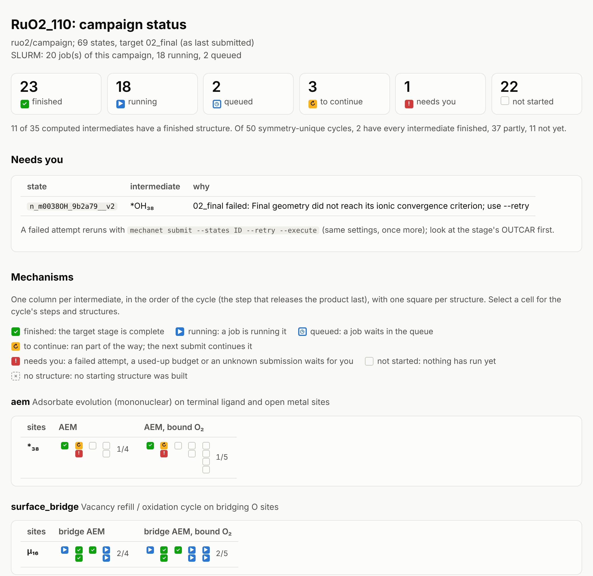
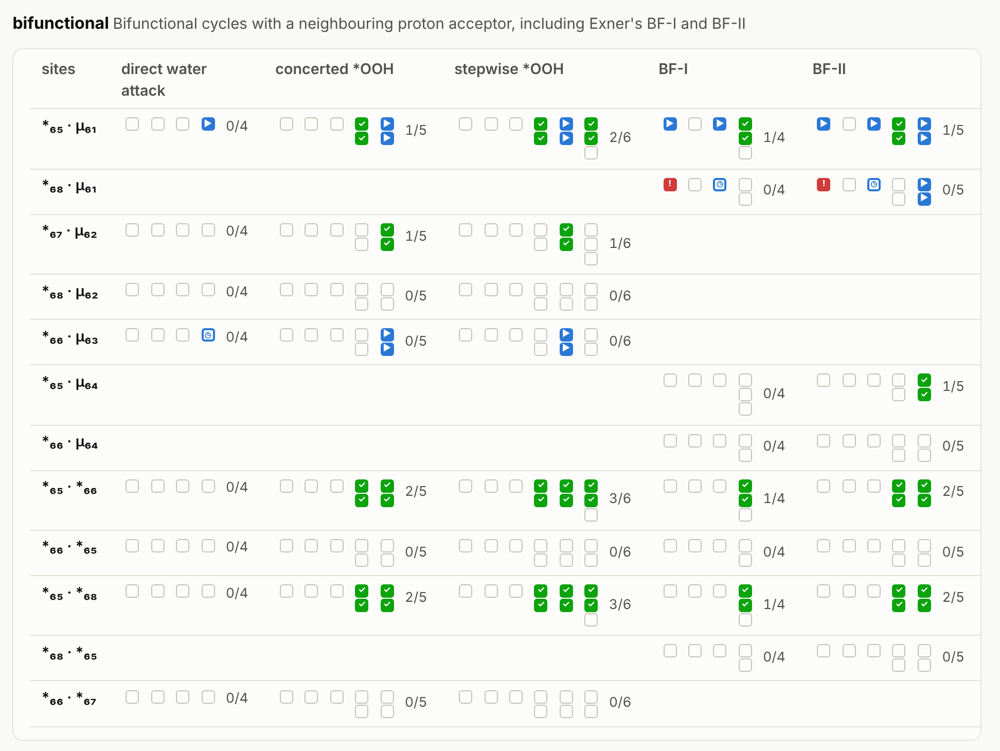
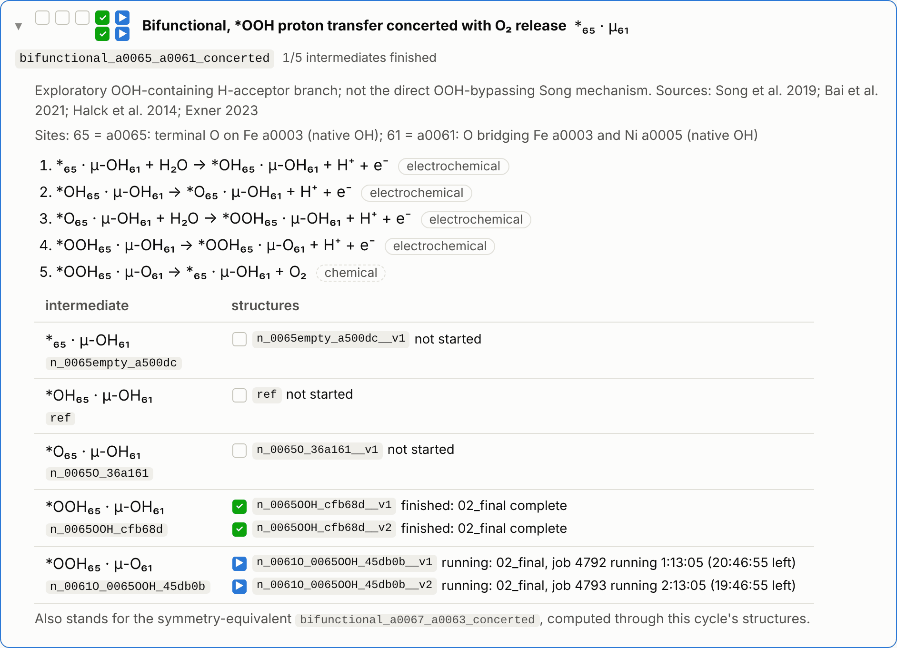

# Following a campaign

A campaign is dozens to hundreds of structures, each going through its own stages and SLURM
jobs. `mechanet status` tells you at any moment what is finished, what is running and what
needs you, for every structure and every mechanism:

```bash
mechanet status
```

It reads the run records of the campaign, the submission ledger and one `squeue` listing of
your jobs, and changes nothing. Besides a summary in the terminal, it writes
`campaign/status.html`: one self-contained file that loads nothing from the internet. Copy it
to your computer (with `scp`, for example) and open it in any browser.



:::{admonition} Try it
:class: tip

<a href="status-example.html">Open an example status page</a>: the NiFe LDH example campaign
with made-up job states. Hover a square, select a cell, and filter the states at the bottom.
:::

## Six groups

Each *state*, one starting structure of one intermediate with its stages, lands in exactly one
group. The group is measured against the stage the state was last submitted for
(`--through STAGE` sets another target), so a state that finished its relaxation but was
submitted for frequencies is still running or to continue.

| | Group | Meaning | What to do |
|:-:|---|---|---|
| <span class="mn-sq mn-finished" role="img" aria-label="finished">✓</span> | finished | The target stage is complete | Nothing |
| <span class="mn-sq mn-running" role="img" aria-label="running">▶</span> | running | A job is running it | Wait |
| <span class="mn-sq mn-queued" role="img" aria-label="queued">◷</span> | queued | A job waits in the queue | Wait |
| <span class="mn-sq mn-continue" role="img" aria-label="to continue">↻</span> | to&nbsp;continue | It ran part of the way: stopped at the time limit, interrupted, or only its earlier stages are done | `mechanet submit --execute` continues it |
| <span class="mn-sq mn-attention" role="img" aria-label="needs you">!</span> | needs&nbsp;you | A failed attempt, a used-up retry budget, frequencies held back by the checks of the single point, or a submission whose outcome is unknown | Read the reason under *Needs you*. After a look at its OUTCAR, `--retry` reruns a failed attempt |
| <span class="mn-sq mn-not_started" role="img" aria-label="not started"></span> | not&nbsp;started | Nothing has run yet | `mechanet submit --execute` |

A dashed square <span class="mn-sq mn-no_structure" role="img" aria-label="no structure">×</span>
marks an intermediate without a starting structure: no placement passed the clash checks
(`campaign/rejected_placements.json` says why).

## The grid of mechanisms

Below the counts, every mechanism family of the campaign has a grid:



- Each **row** is a site or a pair of sites, named in the [notation below](#reading-the-labels):
  `*₆₅ · μ₆₁` is the terminal site a0065 with the bridging site a0061.
- Each **column** is one route of the family, here the direct water attack, the concerted and
  stepwise \*OOH routes, and Exner's BF-I and BF-II.
- Each **cell** is one catalytic cycle. It has one column of squares per intermediate, in the
  order of the cycle (the step that releases O₂ comes last), and one square per starting
  structure of that intermediate.
- The **fraction** counts the intermediates with at least one finished structure. A cycle
  whose fraction is full (in bold) has every energy it needs.
- An **empty cell** means the family has no such route for these sites.

In the first row, the BF-I cycle reads: the first intermediate's only structure is running,
the second has not started, the third is running, and the fourth has three structures, two
finished and one not started, so one of four intermediates is done (1/4). In the second row,
the first structure of BF-I needs you and the third waits in the queue.

Hover a square to see its intermediate, its state ID and its status, with the job ID and the
time left for a running job.

## One cycle

Select a cell, and the cycle opens below the grids: its title and literature, the sites, the
steps as reaction equations, and every structure of every intermediate with its status.



A step is *electrochemical* when an electron crosses the interface and *chemical* when none
does. `mechanet show-cycle ID` prints the same steps in the terminal. At the bottom of the
page, *Jobs* lists the campaign's SLURM jobs and *States* every state with its intermediate,
group and stage; the buttons above it show one group at a time.

## In the terminal

The summary counts the groups, the intermediates and the cycles that are complete, per family,
and lists what needs you and the jobs of the campaign:

```text
RuO2_110: 69 states, target 02_final (as last submitted; 02_final where never submitted)
SLURM: 20 job(s) of this campaign (18 running, 2 queued)

  ✓ finished 23   ▶ running 18   ◷ queued 2
  ↻ to continue 3   ! needs you 1   ⋅ not started 22

Intermediates: 11 of 35 have a finished structure
Cycles (50 symmetry-unique): 2 with every intermediate finished, 37 partly, 11 not yet
  aem                          2 cycles: 0 complete, 2 partly, 0 not yet
  bifunctional                10 cycles: 0 complete, 5 partly, 5 not yet
  hydrated                    12 cycles: 2 complete, 6 partly, 4 not yet
  pair_coupling               12 cycles: 0 complete, 12 partly, 0 not yet
  surface_bridge               2 cycles: 0 complete, 2 partly, 0 not yet
  terminal_bridge_coupling    12 cycles: 0 complete, 10 partly, 2 not yet

Needs you:
  n_m0038OH_9b2a79__v2  02_final failed: Final geometry did not reach its ionic convergence criterion; use --retry

Jobs:
     5120428  RUNNING        2:00:41  n_0016OH_m0046O_845654__v1  *O₄₆ · μ-OH₁₆
     5120429  RUNNING        3:13:41  n_0016OH_m0046O_845654__v2  *O₄₆ · μ-OH₁₆
     5120430  RUNNING        4:26:41  n_0016OOH_6ccd66__v1  μ-OOH₁₆
     ...
```

`--cycles` adds one line per symmetry-unique cycle, with one mark per intermediate (the best
status among its structures):

```text
$ mechanet status --cycles
...
Cycles (one mark per intermediate, release step last):
  aem
    *₃₈        AEM                              ✓↻⋅⋅    1/4  aem_m0038_AEM
    *₃₈        AEM, bound O₂                    ✓↻⋅⋅⋅   1/5  aem_m0038_bound_OO
  surface_bridge
    μ₁₆        bridge AEM                       ▶✓✓▶    2/4  surface_bridge_a0016_AEM
    μ₁₆        bridge AEM, bound O₂             ▶✓✓▶▶   2/5  surface_bridge_a0016_bound_OO
  pair_coupling
    μ₁₆ · μ₁₉  direct O–O coupling              ▶✓✓✓✓   4/5  pair_coupling_a0016_a0019_0016R_0019R_0016D_0019D_direct
    ...
```

`--list GROUP` prints the state IDs of one group, one per line, ready for `--states @FILE`:

```bash
mechanet status --list todo > todo.txt          # to continue and not started
mechanet submit --states @todo.txt --execute
```

The groups are `finished`, `running`, `queued`, `continue`, `attention` (needs you) and
`not-started`, and two combinations: `active` (running and queued) and `todo` (to continue and
not started).

| Option | Use |
|---|---|
| `--through STAGE` | Measure every state against this stage, for example `freq` once the frequencies are submitted |
| `--cycles` | Every symmetry-unique cycle, one mark per intermediate |
| `--list GROUP` | The state IDs of one group |
| `--no-slurm` | Do not call `squeue`, on a machine without SLURM; submitted jobs then count as queued |
| `--no-html` | Do not write `status.html` |

Terminals that cannot show the marks and subscripts get an ASCII form (`#` finished, `>`
running, `q` queued, `~` to continue, `!` needs you, `.` not started).

## Reading the labels

Intermediates, sites and steps are written the same way in `status`, `show-cycle`, the
report and the free-energy profiles:

| Label | Meaning |
|---|---|
| `*₃₈` | The bare metal of site m0038: `*` marks a terminal site (a terminal ligand or an open metal site), the subscript is the site number |
| `*OH₃₈`, `*O₃₈`, `*OOH₃₈` | OH, O or OOH on that metal |
| `*(H₂O)₃₈` | Water bound to it; formulas with digits are bracketed |
| `μ-O₁₆` | The bridging O of site a0016: `μ-` marks a bridging site |
| `μ-OH₁₆` | That bridge protonated |
| `μ-□₁₆` | The bridge with its O removed: a vacancy |
| `μ₃-O₇₀` | The O of site a0070, shared by three metals |
| `*O₄₆ · μ-OH₁₆` | One intermediate with two sites changed; `·` separates the sites |
| `μ-O₁₆–μ-O₁₉` | Two O coupled into an O–O bond |
| `*₆₅ · μ₆₁` | In a grid row: the sites themselves, without their occupants |

The site number is the number of the site's atom (a0065 → 65) or, for an open metal site, of
its metal (m0038 → 38). Steps are equations such as `*O₃₈ + H₂O → *OOH₃₈ + H⁺ + e⁻`, and every
cycle is listed with the step that releases the product (O₂, or Cl₂ for CER) last. In ASCII,
`*OOH₆₅ · μ-O₆₁` becomes `*OOH65 & mu-O61`.

## How status decides

A state's target stage is `--through STAGE` when given, else the target of a running refill,
else the stage its last submission asked for, else 02_final. A job counts for a state when the
ledger records it or when it runs in the state's folder, so jobs you submitted by hand count
too. Without SLURM
(`--no-slurm`, or `squeue` not found), a submission in the ledger with nothing run yet counts
as queued, and an attempt recorded as running counts as running.
[Execution](execution.md#10-following-a-campaign-mechanet-status) has the details.
