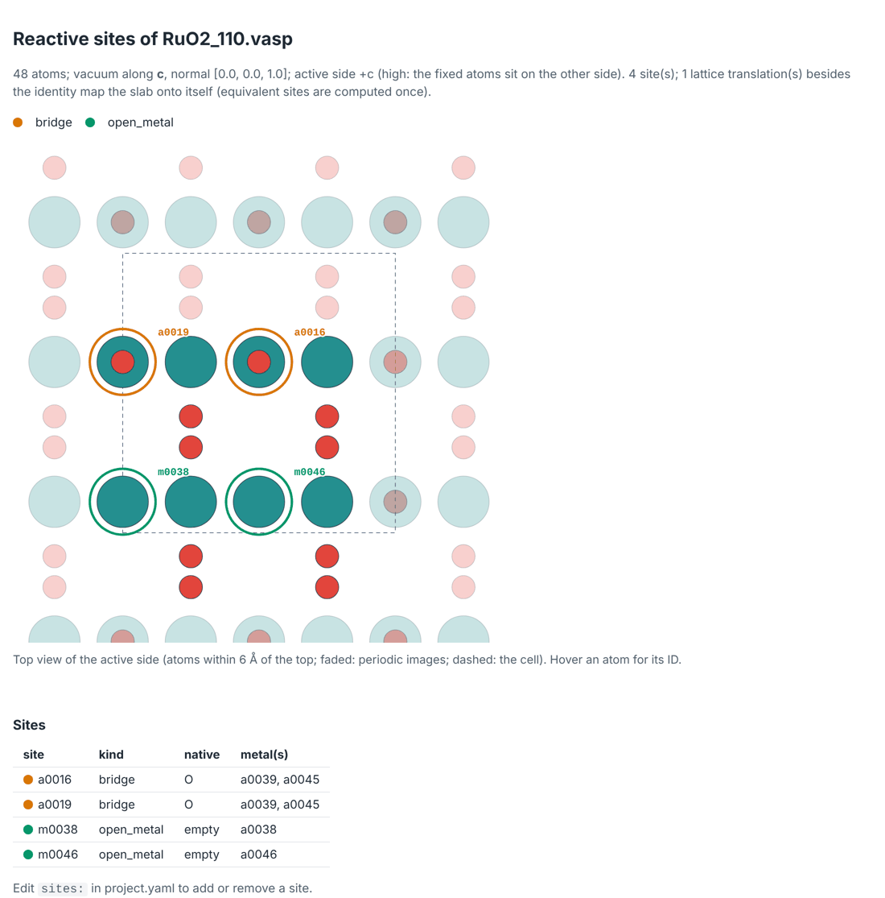

# Getting started

## Install

```bash
pip install "mechanet[plots]"
```

mechanet needs Python 3.10 or newer and brings numpy, ase, spglib, networkx and pyyaml; the
`plots` extra adds matplotlib for the figures. Until the first release is on PyPI, install it
from the repository: `pip install "mechanet[plots] @ git+https://github.com/dhernandezcastillo/mechanet.git@v0.1.4"`.
`mechanet --version` checks the installation.

On the cluster, install it in an environment the compute nodes can see, for example a virtual
environment on a shared file system: each job runs mechanet with the Python that ran
`mechanet submit`. VASP and its PAW datasets are not part of mechanet; you need a licensed VASP
installation.

## A first network in two minutes

No cluster is needed to build a network and see what it will cost:

```bash
mechanet examples RuO2_110              # an example slab: RuO2(110), 48 atoms
mechanet init RuO2_110.vasp ruo2 --yes  # find the sites, accept every proposal
cd ruo2
mechanet generate                       # build the network and the starting structures
mechanet plan                           # what it will cost
mechanet show-cycle aem_m0038_AEM       # one mechanism, as equations
```

`init` reports what it found in the slab and writes `ruo2/project.yaml`, the DFT inputs and
`ruo2/slab/site_map.html`. Open the site map in a browser to check the sites:



`generate` then builds 63 intermediates, 146 steps and 100 catalytic cycles from the literature
mechanisms, with 62 starting structures ready for VASP, and `show-cycle` prints one of them:

```text
aem_m0038_AEM: Adsorbate evolution (AEM)  [aem; oer]
  Proposed on this surface. Sources: Rossmeisl et al. 2005, 2007; Man et al. 2011; Dionigi et al. 2020; Shi et al. 2025
  sites: 38 = m0038: open site on Ru a0038 (bare)
  1. *₃₈ + H₂O → *OH₃₈ + H⁺ + e⁻     electrochemical
  ...
  4. *OOH₃₈ → *₃₈ + O₂ + H⁺ + e⁻     electrochemical
```

[Tutorial 1](tutorials/first-network.md) goes through these commands one by one, and
[tutorial 2](tutorials/own-slab.md) starts from your own slab.

## A study, step by step

Each command is `mechanet COMMAND`; those that submit jobs show a preview until you add
`--execute`.

::::{container} mn-nowrap-code

| Step | Command | What happens |
|---|---|---|
| 1 | `init SLAB` | Finds the vacuum axis, active side, fixed region, reactive sites, symmetry and site pairs; proposes the partial-Hessian region, PAW datasets, starting moments and (for oxides) Hubbard U values; writes the project, the DFT inputs and the site map. [Tutorial 2](tutorials/own-slab.md) |
| 2 | `generate` | Builds the network from the mechanism families of the scope, places every adsorbate without clashes, merges lattice-translation images of intermediates, skips starts that are rotations or mirror images of each other, and writes the starting structures. No DFT. [Tutorial 1](tutorials/first-network.md#5-build-the-network) |
| 3 | `plan`, `cycles`, `show-cycle` | Counts intermediates, cycles, structures and calculations, with node-hours once the pilot has run. [Tutorial 1](tutorials/first-network.md#6-see-what-it-will-cost) |
| 4 | `prescreen --calculator mace-mp` (optional) | Relaxes every start with an ML potential, checks it as a DFT result would be checked, and lists the starts worth DFT, for `submit --states @campaign/prescreen/suggested_states.txt`. Nothing in the campaign changes. [Pre-screening](prescreening.md) |
| 5 | `submit --pilot` | The reference surface, one start per adsorbate and the most crowded start: checks your protocol and measures timings. [Tutorial 3](tutorials/cluster.md#5-run-the-pilot) |
| 6 | `submit`, then `status` | Every structure through `02_final`; repeat it whenever you like, and jobs stopped at the time limit continue. `status` shows where everything stands. [Following a campaign](following-a-campaign.md) |
| 7 | `collect`, `review`, `select` | Parses and checks every run and assigns each relaxed structure to the intermediate it became; `review` lists the finished structures that changed during the relaxation and records your decisions; `select` picks the variants that continue to frequencies. [Checking results](checking-results.md) |
| 8 | `submit --selected --through freq` | The single point and the partial Hessian, by restartable finite displacements. [Execution](execution.md#5-frequencies-by-restartable-displacements) |
| 9 | `thermo` | Free energies of every intermediate, step and cycle; limiting potentials, overpotentials, Gmax(U), resting states, and the magnetic moments along each cycle. [Tutorial 4](tutorials/analysis.md) |
| 10 | `pathways --rank` | Every balanced cycle of the network, written down or not, ranked: the route of lowest limiting potential. [Tutorial 4](tutorials/analysis.md#5-rank-every-pathway-not-only-the-written-ones) |
| 11 | `pourbaix --plot` | The most stable computed termination over pH and potential. [Tutorial 4](tutorials/analysis.md#6-draw-the-surface-pourbaix-diagram) |
| 12 | `report` | `report.md` with the network, the progress and every analysis so far. [Tutorial 4](tutorials/analysis.md#7-write-the-report) |

::::

Every command prints a readable summary, or JSON with `--json`, and finds the project and its
campaign by itself when you run it inside the project folder.

## What you can study

| Reaction | Net, per turnover | Potential scale | Mechanism families |
|---|---|---|---|
| `oer`, oxygen evolution | 2 H₂O → O₂ + 4 (H⁺ + e⁻) | RHE | `aem`, `surface_bridge`, `pair_coupling`, `terminal_bridge_coupling`, `bifunctional`, `hydrated`, and `oo_oo` |
| `cer`, chlorine evolution | 2 Cl⁻ → Cl₂ + 2 e⁻ | SHE | `cer_volmer_heyrovsky`, `cer_ocl`, and `cer_volmer_tafel` |
| your own | from a [plugin](plugins.md), such as the HER example | RHE or SHE | yours |

A *family* writes one kind of mechanism for every site or pair of sites it applies to:
adsorbate evolution on one site, O–O coupling between two sites, proton transfer to a
neighbouring acceptor, and so on. [What mechanet computes](science.md#2-mechanism-families)
describes each family and its literature. Two more families serve other purposes: `coverage`
builds terminations for Pourbaix diagrams, and `enumerated` builds every occupancy of chosen
sites. Slabs can be oxides, hydroxides, layered materials, metals or single-atom catalysts in
a 2D host.

## Where next

::::{grid} 1 2 2 2
:gutter: 3

:::{grid-item-card} Tutorials
:link: tutorials/index
:link-type: doc

From an example slab to free energies, Pourbaix diagrams and your own mechanisms.
:::

:::{grid-item-card} Following a campaign
:link: following-a-campaign
:link-type: doc

What is finished, running or waiting for you, per structure and per mechanism.
:::

:::{grid-item-card} project.yaml reference
:link: project-file
:link-type: doc

Every setting of a project, with its default.
:::

:::{grid-item-card} Troubleshooting
:link: troubleshooting
:link-type: doc

Common messages and what to do about them.
:::
::::
