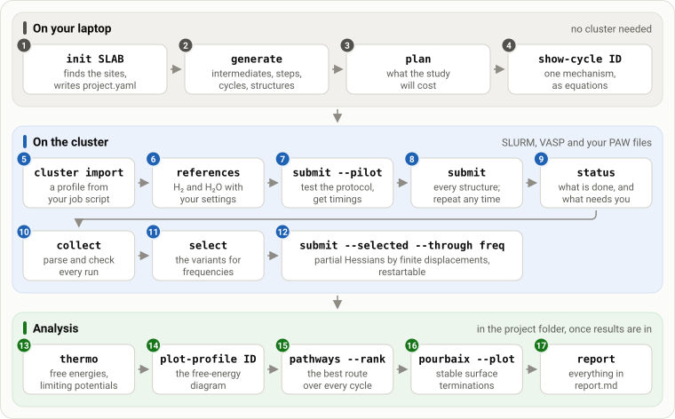

# mechanet

**Reaction networks for electrocatalysis on surfaces, from the slab file to free energies.**

mechanet finds the reactive sites of a slab and builds every intermediate, step and catalytic
cycle that the literature proposes for a reaction: oxygen and chlorine evolution are built in,
and plugins add others. It writes a starting structure for every intermediate, runs them through
a staged, restartable VASP protocol on your SLURM cluster, and analyses the results with the
computational hydrogen electrode: limiting potentials, Gmax(U), resting states, the route of
lowest overpotential over every cycle of the network, and surface Pourbaix diagrams.

::::{container} mn-buttons
:::{button-ref} getting-started
:ref-type: doc
:color: primary

Get started
:::
:::{button-ref} tutorials/index
:ref-type: doc
:color: secondary
:outline:

Tutorials
:::
:::{button-ref} following-a-campaign
:ref-type: doc
:color: secondary
:outline:

Following a campaign
:::
::::

## What you get

::::{grid} 1 2 2 2
:gutter: 3

:::{grid-item-card} The sites of your slab
:img-top: images/gallery-sites.png
:img-alt: Site map of RuO2(110): two bridging O ringed in orange, two open Ru sites ringed in green
:link: tutorials/first-network
:link-type: doc

`mechanet init` finds the vacuum, the active side, the fixed atoms and the reactive sites,
and draws them before anything is computed.
:::

:::{grid-item-card} Every calculation at a glance
:img-top: images/gallery-status.png
:img-alt: Status grid: rows of site pairs, columns of mechanisms, one coloured square per structure
:link: following-a-campaign
:link-type: doc

`mechanet status` shows each site and mechanism of a running campaign, with one square per
structure: finished, running, queued, or waiting for you.
:::

:::{grid-item-card} Free-energy profiles
:img-top: images/gallery-profile.png
:img-alt: Free-energy profile of the adsorbate-evolution cycle on RuO2(110) at 1.23 V
:link: tutorials/analysis
:link-type: doc

Free energies, limiting potentials and Gmax(U) for every cycle, and the local magnetic
moments of the active site along the way.
:::

:::{grid-item-card} Surface Pourbaix diagrams
:img-top: images/gallery-pourbaix.png
:img-alt: Surface Pourbaix diagram of the computed terminations of RuO2(110)
:link: tutorials/analysis
:link-type: doc

The most stable computed termination over pH and potential, with exact phase boundaries.
:::
::::

## How a study runs



Each box is one `mechanet` command, in the order you run it. Only the middle band needs SLURM
and VASP, and nothing is submitted until you add `--execute`. The
[tutorials](tutorials/index.md) go through the bands one at a time.

## Mechanisms written as chemistry

Every intermediate, step and cycle has a readable name. `mechanet show-cycle` prints a cycle
as reaction equations, with the step that releases O₂ last:

```text
$ mechanet show-cycle bifunctional_a0065_a0061_BF2
bifunctional_a0065_a0061_BF2: Bifunctional mechanism II (BF-II)  [bifunctional; oer]
  Exner (Mater. Horiz. 2023) bifunctional mechanism II after Halck et al. 2014, with the neighbouring O as proton acceptor. Sources: Song et al. 2019; Bai et al. 2021; Halck et al. 2014; Exner 2023
  sites: 65 = a0065: terminal O on Fe a0003 (native OH); 61 = a0061: O bridging Fe a0003 and Ni a0005 (native OH)
  1. *₆₅ · μ-O₆₁ + H₂O → *OH₆₅ · μ-O₆₁ + H⁺ + e⁻   electrochemical
       n_0061O_0065empty_81385d -> n_0061O_272e65   [Water refills the donor site (M + *O_A + H2O -> M-OH + *O_A + H+ + e-).]
  2. *OH₆₅ · μ-O₆₁ → *O₆₅ · μ-O₆₁ + H⁺ + e⁻        electrochemical
       n_0061O_272e65 -> n_0061O_0065O_a3e24f   [Donor OH deprotonation (M-OH + *O_A -> M-O + *O_A + H+ + e-).]
  3. *O₆₅ · μ-O₆₁ + H₂O → *OOH₆₅ · μ-OH₆₁          chemical
       n_0061O_0065O_a3e24f -> n_0065OOH_cfb68d   [BF-II chemical water attack: M-O + *O_A + H2O -> M-OOH + *OH_A (no reservoir exchange).]
  4. *OOH₆₅ · μ-OH₆₁ → *OOH₆₅ · μ-O₆₁ + H⁺ + e⁻    electrochemical
       n_0065OOH_cfb68d -> n_0061O_0065OOH_45db0b   [Regenerate the deprotonated proton acceptor.]
  5. *OOH₆₅ · μ-O₆₁ → *₆₅ · μ-O₆₁ + O₂ + H⁺ + e⁻   electrochemical
       n_0061O_0065OOH_45db0b -> n_0061O_0065empty_81385d   [BF-II release: M-OOH -> M + O2 + H+ + e-.]
  symmetry-equivalent: bifunctional_a0067_a0063_BF2
```

This is a cycle of the NiFe LDH example. `*OOH₆₅` is OOH on the Fe of site a0065, and
`μ-O₆₁` is the O that bridges Fe and Ni at site a0061. Under each step are the IDs of its two
intermediates and a note. The same names label the status page, the free-energy profiles and
the report; [Reading the labels](following-a-campaign.md#reading-the-labels) explains them.

## What it does not do

mechanet computes thermodynamics under the computational hydrogen electrode. It does not
compute activation barriers, rates, or constant-potential energetics, and a favourable
descriptor does not prove a mechanism. Placements and water arrangements are sampled, not
exhausted, and every structure starts from the same magnetic moments: mechanet reports when
intermediates end in different magnetic solutions but does not search for them. On metal
surfaces adsorbates sit on top sites only. [What mechanet computes](science.md) states what
each number means and what is left out.

## Citing

If mechanet helps your work, please cite the software (see
[CITATION.cff](https://github.com/dhernandezcastillo/mechanet/blob/main/CITATION.cff)) and
the papers behind the mechanisms and descriptors you use: `mechanet plugins` and every
`network.json` record their literature keys, and the
[literature list](science.md#10-literature) gives the full references.

```{toctree}
:hidden:
:caption: Start here

getting-started
tutorials/index
```

```{toctree}
:hidden:
:caption: Using mechanet

following-a-campaign
checking-results
troubleshooting
```

```{toctree}
:hidden:
:caption: Guides

project-file
execution
prescreening
model-files
science
plugins
```

```{toctree}
:hidden:
:caption: Reference

commands
pending
coverage-shortlist
changelog
```
