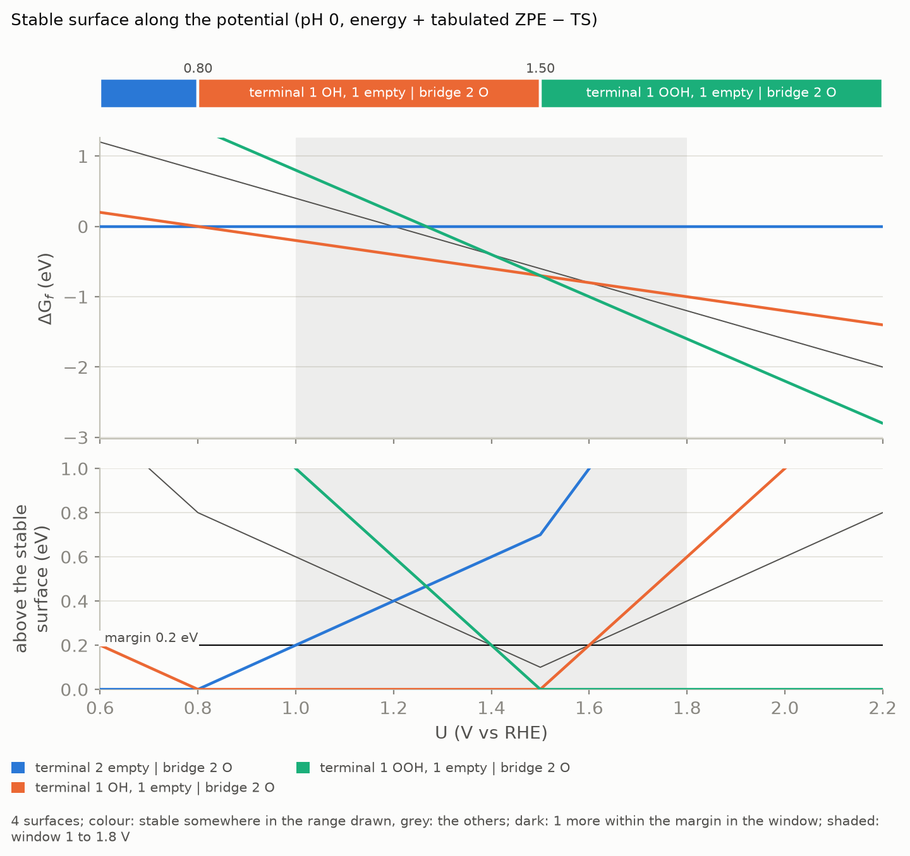

# Surface first: coverage, then the mechanism

A mechanism runs on a surface, and which surface a catalyst shows depends on the potential.
The slab file you start from carries one termination; under reaction conditions the sites
may hold other adsorbates. The usual procedure in computational electrocatalysis therefore
has two stages: a surface Pourbaix diagram first, built from many coverages of the sites, and
the mechanism second, on the surfaces the diagram selects. Usama, Razzaq, Hättig, Steinmann
and Exner (*Nat. Commun.* **16**, 6137 (2025)) do this for IrO2(110) and carry four surfaces
of comparable stability into the mechanistic analysis, not one.

This page follows that order.

## 1. Probe adsorbates on the sites

List in `project.yaml` the states to try, per kind of site or per single site:

```yaml
scope:
  families: [aem, bifunctional]        # the mechanism, for later
  coverage:
    states:
      terminal: [O, OH, H2O, OOH]      # every terminal site is tried in these states
      bridge: [O, OH]
      a0065: [O, OH]                   # one site can have its own list
    max_changed_sites: null            # null: every combination; 2 (the default): up to two sites at once
```

Any adsorbate the campaign knows can be listed on any site: `empty` (a vacancy, or a bare
metal), O, OH, H2O, OOH and OO are built in, Cl and OCl come with the chlorine evolution
reaction, and a plugin adds others ([plugins](plugins.md)). A site keeps its ID from
`mechanet init`; `sites:` restricts the probe to some of them.

Count before you build:

```bash
mechanet generate --coverage --count
```

```text
coverage: 256 surfaces on 8 sites, 136 distinct after symmetry (bridge: O, OH; terminal: O, OH; every combination)
  nothing built (--count)
```

The first number is every combination, the slab as given included. The second leaves out
surfaces that a lattice translation of the slab maps onto another one: they are the same
calculation, so only one of them is built and run. The example is the edge of the NiFe
layered double hydroxide with O or OH on its four terminal and four bridging sites.

Then build the campaign:

```bash
mechanet generate --coverage
```

It goes to `<project>/coverage`, next to the mechanism campaign that `mechanet generate`
writes to `<project>/campaign`, and is run, followed and checked like any campaign
(`plan`, `submit`, `status`, `review`). It holds surfaces only: no steps and no cycles.

Three things keep the count affordable:

* **Fewer states.** Four states on four sites and two on four others are 4,096 surfaces.
* **`max_changed_sites`.** With 2, only surfaces that differ from the slab at one or two sites
  are built: a look at the neighbourhood of the termination you have.
* **Two passes.** O and OH everywhere first; the other adsorbates in a second campaign, on
  the surfaces the first diagram brings out.

`generate --coverage` warns above 400 distinct surfaces.

A surface with many adsorbates that need an orientation (OH, OOH, water) is placed with a
shorter search than an intermediate of a mechanism: two placement orders instead of all of
them, which would be 40,320 for eight sites ([science §3](science.md#3-starting-structures)).
The build report says for how many surfaces this was done.

After the relaxations, `mechanet review` tells which structures still are the surface they
were built as. This matters more here than anywhere else: with many adsorbates next to each
other, protons move, water forms and O–O bonds close during relaxation, and a structure that
became another surface must not be counted under the name of the one it started as.
`mechanet pourbaix` uses each structure for the surface it has become
([checking results](checking-results.md)).

## 2. Read the diagram and list the candidates

Once the surfaces are relaxed, draw the diagram and ask for the candidates in the potential
window you care about:

```bash
mechanet pourbaix --screening --scale RHE --window 1.0:1.8 --figures
```

```text
  candidates between 1 and 1.8 V vs RHE at pH 0 (stable there, or within 0.2 eV of the stable surface):
     1  terminal 1 OH, 1 empty | bridge 2 O   n_m0038OH_9b2a79   stable 0.80 to 1.50 V, ahead by at most 0.40 eV  [no free energy yet]
     2  terminal 1 OOH, 1 empty | bridge 2 O  n_m0038OOH_5560a2  stable above 1.50 V, ahead by at most 0.40 eV (gives the product off downhill)  [no free energy yet]
     3  terminal 1 O, 1 empty | bridge 2 O    n_m0038O_d0b786    0.10 eV above the stable surface at 1.50 V  [no free energy yet]
     4  terminal 2 empty | bridge 2 O         ref                0.20 eV above the stable surface at 1.00 V  [no free energy yet]
    (candidates.csv; `mechanet select --candidates` sends them to the frequency stage, `mechanet generate --on ID` builds the mechanism on one)
```

The numbers are those of the example of [tutorial 4](tutorials/analysis.md). A candidate is a
surface that is the most stable one somewhere in the window, or lies within the margin of the
most stable one somewhere in it. The distance is exact: it is smallest at an end of the window
or where the stable surface changes, and these points are evaluated. Each row gives:

* the name of the surface (how many sites of each class are in each state) and its ID;
* for a stable surface, the range over which it is stable and its lead: by how much it
  beats its closest competitor at most. A lead of a few hundredths of an eV is a stability
  the method cannot assert;
* for the others, how far above the stable surface they come at their closest, and where;
* a note when the surface gives the product off downhill there: then it is an intermediate
  of the reaction under turnover, not a surface at rest.

`--margin` sets the distance (0.2 eV per cell by default, about what separates two surfaces
that density-functional theory cannot rank) and `--window-pH` the pH (default: the campaign's
`thermodynamics.pH`; on the RHE scale it does not matter when every step is a proton-coupled
electron transfer). `candidates.csv` holds the table and `compositions.csv` the surfaces
grouped by composition: how many were computed for each, the lowest one, how far the others
lie above it, and how far that lowest one is from being stable at the two ends and the middle
of the window (`--at-potential` chooses other potentials).

### Two levels, and frequencies for the candidates only

`--screening` uses the relaxed energy plus a tabulated ZPE − TS for every atom the surface
has more or less than the slab (0.30 eV per H and 0.05 eV per O by default,
`thermodynamics.electronic_mode_corrections`). It needs no frequency calculation, so it is
available for every surface as soon as it is relaxed: the energy is that of the relaxation
(`02_final`) under either protocol. (`--electronic-only` applies the same corrections to the
energies the protocol analyses, which with `frequency.central: refine` are those of
`04_static` and do not exist yet at this point.) Energies alone are not a level to choose
surfaces with: every proton removed changes the vibrational terms by about 0.3 eV, so the
transitions move by tenths of a volt.

The screening level ranks surfaces that are far apart correctly and can swap two that are
close. Hence the margin, and the second pass:

```bash
mechanet select --candidates        # only the candidates and the reference surface go on
mechanet submit --execute
mechanet pourbaix --scale RHE --window 1.0:1.8 --figures     # now with free energies
```

`select --candidates` sends the candidates and the reference surface (the slab as given):
every formation energy is counted from it, so its free energy is needed even when it is not
a candidate itself, and `select` says that it added it. Without `--screening` the diagram
uses free energies and contains the surfaces that have one. A candidate without a frequency
calculation is marked `[no free energy yet]` in the table.

### The figures

`--figures` writes five figures next to the tables, at the pH of the candidates:

| File | What it shows |
|---|---|
| `pourbaix_lines.png` | The stable surface along the potential with the potentials where it changes; ΔG_f(U) of every surface; and how far each surface lies above the stable one, with the margin as a line. A surface is stable where its curve touches zero. |
| `pourbaix_hull.png` | Every surface as a point over the electrons released on forming it, at the middle of the window. The corners of the lower convex hull are the stable surfaces, and the potential under each edge is the transition between its two ends. A point just above the hull is almost stable. |
| `pourbaix_margins.png` | Per composition, how far its lowest surface is from being stable at each potential of `compositions.csv`. |
| `pourbaix_levels.png` | The stable surface along the potential with free energies, with tabulated corrections, and with energies alone. A level that cannot be evaluated yet says so. |
| `pourbaix_isomers.png` | The surfaces of each composition above the lowest one (drawn when a composition has more than one). Marks close together are surfaces that need the higher level to be told apart. |



A surface keeps its colour in all figures of a run, and every number in them is in
`candidates.csv`, `compositions.csv` or `pourbaix.json`.

### What the diagram cannot tell

* Only surfaces that were computed can appear. A structure that turned into another surface
  during relaxation counts for the surface it became; one that became a surface the campaign
  does not list is reported by `mechanet review`, which can add it (`--discover`).
* The cell fixes the coverages: with four sites of a kind, a quarter is the smallest step.
* Configurational entropy and the interactions with the electrolyte are not included, as in
  any diagram from the computational hydrogen electrode
  ([science §7](science.md#7-surface-pourbaix-diagrams)).
* Surfaces can differ in their magnetic solution; `mechanet select` reports intermediates
  whose variants converged to different ones.

## 3. Pick the surfaces and build the mechanism on each

Give `generate` the ID of a candidate (they are in the table and in `candidates.csv`):

```bash
mechanet generate --on n_m0038OH_m0046OH_69d918
```

```text
campaign: ruo2/on_n_m0038OH_m0046OH_69d918
  on the surface n_m0038OH_m0046OH_69d918: terminal 2 OH | bridge 2 O (n_m0038OH_m0046OH_69d918)
  10 finished calculations of 9 intermediates copied from ruo2/coverage; 5 new intermediates start from the relaxed surface (n_m0038OH_m0046OH_69d918__v1)
  candidate nodes: 25
  ...
```

Repeat `--on` to build one campaign per surface in one go. Each goes to its own folder,
`<project>/on_NAME`, and is planned, run, checked and analysed like any campaign: its
cycles, its `pathways`, its limiting potentials are those of the mechanism on that surface.

What the campaign contains:

* **The families of `scope.families`, written on the surface.** A family names the states
  of the sites it works on: the adsorbate evolution on a terminal site writes that site as
  empty, OH, O, OOH and OO. Every site it does not name keeps the state it has on the picked
  surface. The families themselves are unchanged, and so are the names of the cycles.
* **The slab as given**, as the zero of energy the coverage campaign and every campaign on a
  surface share. Formation energies are therefore on one scale across them.
* **The finished calculations of the coverage campaign**, for every intermediate it already
  has: the picked surface itself, the slab as given, and any other surface of the coverage
  campaign that the mechanism passes through. Their folders are copied as they are, with a
  note of where they come from (`imported.json`); nothing is computed twice, and the coverage
  campaign is only read. A calculation whose relaxed structure is no longer the surface it
  was built as is not copied: that intermediate gets a fresh start here. A start that has
  not finished there is left behind when another start of the same intermediate has; both
  are said and listed (`surface.not_copied` in `build_report.json`). The copies are a
  snapshot: build the campaign when the coverage campaign has finished what you want from it.
* **New intermediates that start from the relaxed surface.** Their atoms sit where the
  surface relaxed; only the sites that differ from the surface are rebuilt and oriented, in
  that environment. This is what one does by hand when editing the CONTCAR of a surface, and
  it keeps the spectators of all intermediates of a cycle in the same arrangement, so that a
  step energy is not the difference between two hydrogen-bond patterns. `state.json` records
  it (`seeded_from`). The atoms of the surface are never turned. If an adsorbate of the
  surface leans over the site so that no start fits next to it, that one intermediate is
  started as in a campaign without the relaxed surface, from the slab with every adsorbate
  placed anew; `generate` says how many, and `surface.started_anew` lists them.

Symmetry follows the surface: of the lattice translations of the slab, only those that map
the surface onto itself merge intermediates. A surface with OH on every second site has
fewer equivalent sites than the bare slab, and more intermediates are computed.

The pattern decides this, not the relaxed structure. Two sites that the pattern makes
equivalent can differ in the relaxed surface (one OH donates a hydrogen bond, its image does
not), and the mechanism is then computed on the first of them only. The build report gives
the largest distance between an atom of the relaxed surface and the place where such a
translation puts it (`surface.equivalent_sites_differ_by_A`), and `generate` says so above
0.5 Å. `geometry.symmetry_reduction: false` computes every site
([open points](pending.md)).

`mechanet pourbaix` on such a campaign labels its intermediates by what differs from the
surface (`the surface`, `m0046:OOH`), so the diagram reads as the neighbourhood of the
surface you picked.

### A surface you already know

A surface can also be written by hand, for instance from a diagram computed elsewhere:

```yaml
surfaces:
  oxidised: {a0061: O, a0063: O}       # the sites that differ from the slab file, and their state
```

```bash
mechanet generate --on oxidised
```

Without a coverage campaign there is nothing to copy and no relaxed surface, so every start
is built from the slab with all adsorbates placed anew. (If you have the relaxed structure of
the surface itself, give that file to `mechanet init` instead: section 4.) To get the starts from the relaxed
surface, relax it first in a campaign of its own and name that campaign with `--from`:
`mechanet generate --on oxidised --from DIR` takes the surface, its relaxed structure and
the finished calculations from any campaign of the same project (`--from none` uses none;
an ID is then still read from the coverage campaign, for its pattern only).
A campaign built from another slab file, or run with other INCAR or KPOINTS files, is
refused: its energies would not be comparable. Other `vasp` or `frequency` settings in
project.yaml are noticed when the copied calculations are prepared, and `prepare` says so.

### A second pass around a surface

`mechanet generate --coverage --on ID` builds the coverage states around a surface instead
of around the slab: the combinations of `scope.coverage` are counted from the surface. With
`max_changed_sites: 2` this probes, for example, OOH, OO and water next to a surface that a
first pass with O and OH brought out, at a fraction of the cost of every combination. The
campaign goes to `<project>/coverage_on_NAME`; surfaces the first pass has relaxed are copied.

## 4. A slab that already carries adsorbates

The slab file you start from may be a surface with adsorbates on it: the relaxed structure of
a termination from an earlier study, with an OOH on a metal or a chloride next to the active
site. `mechanet init` reads such a group as what it is, the state of a site:

```text
  adsorbates the slab carries (1): OOH on a0040 (a0033, a0034, a0051)
    `mechanet init` reads them as states of sites: the campaign is built on the slab as given, and they can react
  the slab without them (49 atoms) is the reference of the campaign; on it the slab as given is the surface a0033: OOH
       a0016  bridge     native O
       a0019  bridge     native O
       a0033  terminal   native O
       m0047  open_metal native empty on a0047
```

Three things happen:

1. **The atoms of the group leave the slab the campaign is referenced to.** For a group on an
   oxygen (OOH, O2, OCl) the oxygen stays and is a terminal or bridging site in the state O;
   the atoms beyond it go. A group bound to one metal through another element (Cl, H, CO) goes
   whole, and the metal is an open metal site. The project keeps three files: the slab as you
   gave it, the slab without the groups (`slab/NAME_bare.vasp`, the one `project.yaml` names)
   and `slab/as_given.json`, which says what was read: the site, its state and where the atoms
   were.
2. **The slab as given becomes a surface**, named `as-given`, and `mechanet generate` builds
   the campaign on it without any option. Its start is the file as you gave it, atom for atom,
   and every other intermediate starts from it with only the sites that differ rebuilt, as in
   section 3. The adsorbate is a state like any other: the families write the mechanism on its
   site and next to it.
3. **Nothing else changes.** An oxygen with zero to two H is a site in the state O, OH or H2O
   as before, and a slab without such groups is read exactly as before.

`mechanet generate --on slab` builds a campaign on the slab without the groups, and `--on
as-given --from DIR` takes finished calculations and the relaxed surface from another campaign
of the project.

A group that cannot be read this way is kept as part of the framework, where it stays
unchanged and does not react, and the inspection says so with the atoms and the reason:

| Group | What `inspect` and `init` say |
|---|---|
| Not a registered adsorbate (a carbonate, an amide without the plugin that defines NH2) | `no registered adsorbate is H2N bound through N ...; a plugin can register it` |
| Bound through several atoms: O2 side-on, a peroxo pair between two sites | `it binds the surface through 2 atoms ...: a pair between two sites or a molecule bound side-on is not the state of one site` |
| Between two or more metals through an element other than oxygen: CO on a bridge, H in a hollow | `H binds 3 metals: an adsorbate bound through an element other than oxygen is written on top of one metal only` |
| Two such adsorbates on one metal | `... holds 2 adsorbates ..., and a metal has one open site` |

Answer `n` to the question of `init` to keep a recognised group in the framework as well.
The site of a carried adsorbate cannot be left out of the sites afterwards: its atoms are no
longer in the slab file, so `init` keeps the site and says so, and `generate` refuses a
project whose `sites` lack it.
Groups of one kind kept for one reason are said in one line. What belongs to the material is
not listed here: a covalent sheet (the nitrogen of an Fe–N4 site leads into the carbon of the
sheet) is the slab itself, and a lone anion between two or more metals (the sulfur of a
sulfide, the fluorine of a fluoride, a bridging chloride) is a ligand of the slab, reported
with the other ligands as before (`exposed ligands not proposed`).

If the reaction has no reservoir for an element the slab carries (the oxygen evolution has
water and protons, no chloride), `init` says so: the mechanism next to the adsorbate can be
studied, but `mechanet pourbaix` cannot place surfaces that hold it. Choose the reaction with
that reservoir (`--reaction cer` for chlorine) or a plugin.
