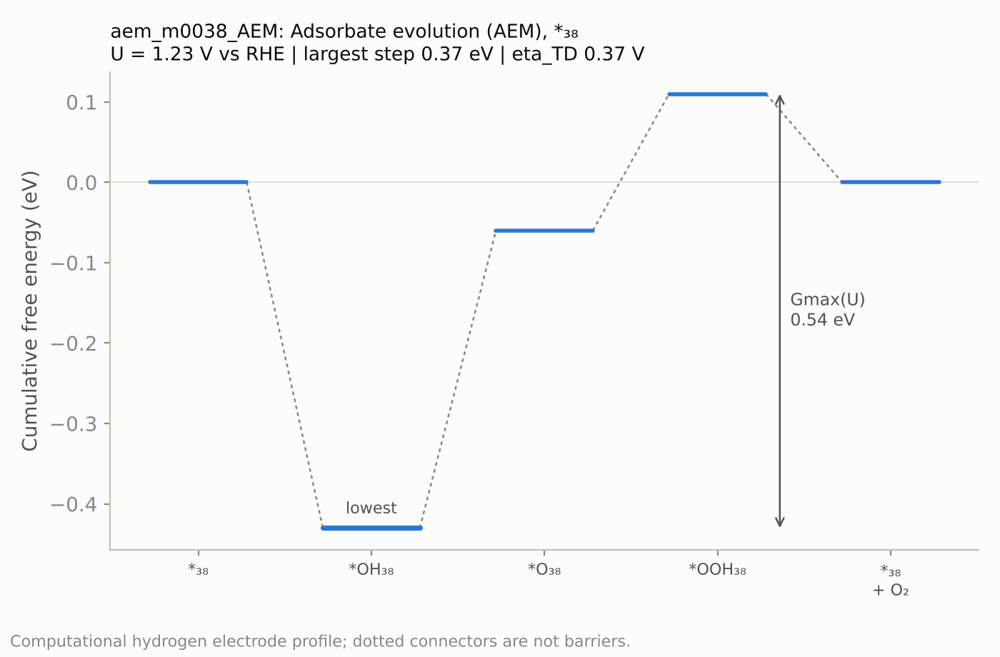
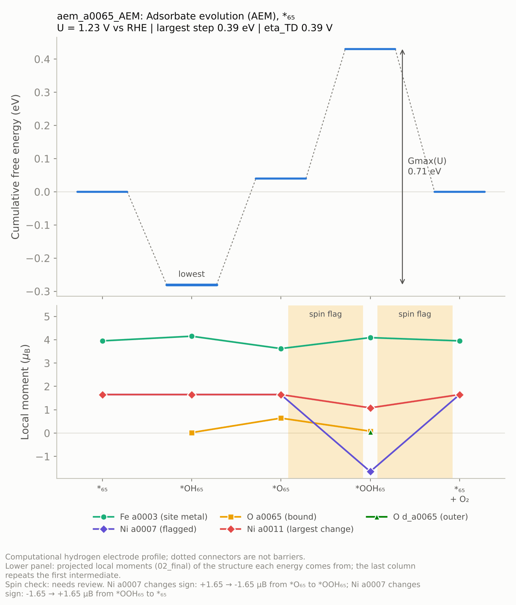
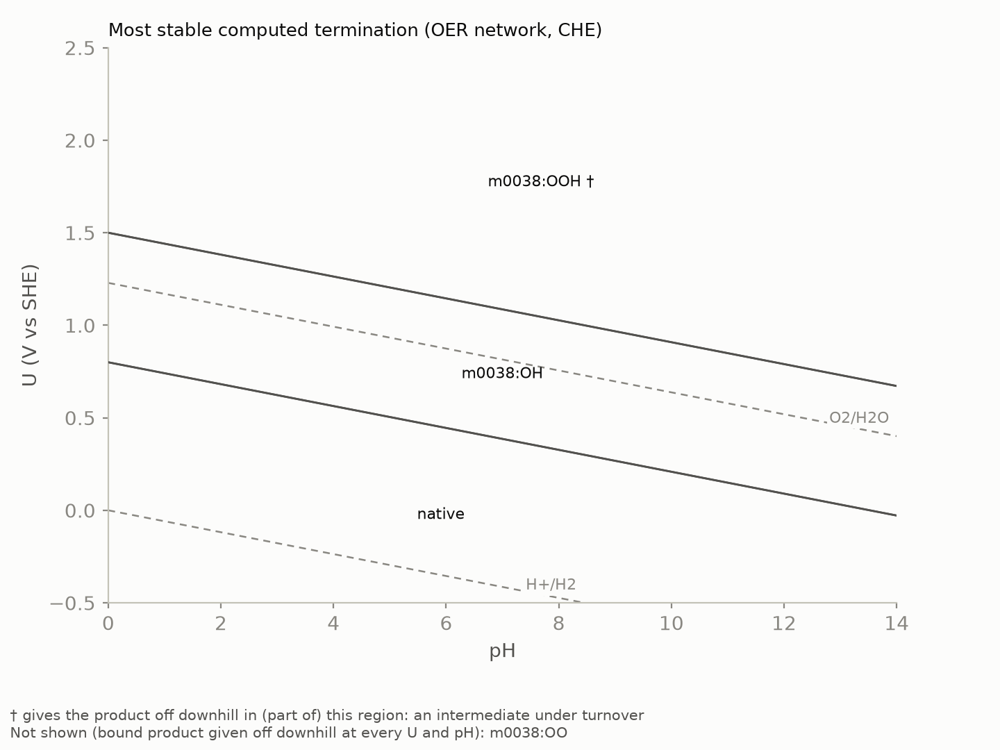

# Tutorial 4: From energies to answers

This tutorial turns a finished campaign into free energies, limiting potentials, a surface Pourbaix diagram and a report. Run each command in the project folder. The output shown comes from a small RuO2(110) campaign (the `aem` family only) whose energies were designed for testing: the commands, files and formats are real, the numbers are not chemistry.

## 1. Screen before the frequencies

```bash
mechanet thermo --electronic-only
```

```text
CHE_screening_final_E0_plus_tabulated_adsorbate_ZPE_TS; potentials vs RHE, pH 0.0
  intermediates with an energy: 9 of 9; cycles with every energy: 4 of 4
  WARNING: Reference DFT protocol identity has not been documented; verify functional, PAWs, U, dispersion and solvation conventions.
  1.23 V (oer): lowest Gmax aem_m0038_AEM 0.540 eV; lowest eta_TD aem_m0038_AEM 0.370 V
  1.43 V (oer): lowest Gmax aem_m0038_AEM 0.170 eV; lowest eta_TD aem_m0038_AEM 0.370 V
  1.53 V (oer): lowest Gmax aem_m0038_AEM 0.070 eV; lowest eta_TD aem_m0038_AEM 0.370 V
  1.63 V (oer): lowest Gmax aem_m0038_AEM -0.030 eV; lowest eta_TD aem_m0038_AEM 0.370 V
  tables in campaign/analysis
```

Without frequencies, each free energy is the 02_final electronic energy plus tabulated zero-point and entropy corrections for the atoms an intermediate adds: 0.30 eV per H and 0.05 eV per O, set in `thermodynamics.electronic_mode_corrections`. That is enough to see which cycles matter and which states deserve frequencies; it is not a result to publish. The first line names the analysis level, and every table, figure and the report carry it, so a screening number cannot pass for a free energy.

| Quantity | What it tells you |
|---|---|
| Limiting potential, U_L | The lowest potential at which every electrochemical step of the cycle runs downhill |
| eta_TD | The thermodynamic overpotential: U_L − 1.23 V for OER |
| Gmax(U) | The largest free-energy climb along the cycle at potential U, from an intermediate to any later one, so two uphill steps in a row add up. Zero or less means downhill all the way |
| Resting state | The most stable intermediate of the network at U. A cycle that never visits it starts higher; `cycles.csv` gives the difference as `resting_state_penalty_eV` |

In the example the hardest single step needs 0.37 eV at 1.23 V, but Gmax is 0.54 eV because the next step climbs another 0.17 eV. At 1.63 V everything runs downhill.

The warning appears because this example's references were typed in by hand. `mechanet references --collect` ([tutorial 3, step 4](cluster.md#4-compute-the-molecular-references)) writes `protocol_id` and the `provenance` flags it can check, and sets the flags again each time it runs. In a file you fill in yourself, describe the protocol as `protocol_id` (for example `"PBE-D3(BJ), 520 eV, PAW PBE 54"`) and set each `provenance` flag to `true` once you have checked it; a flag left `false` adds a warning to every analysis.

## 2. Compute the free energies

Once the frequency jobs of [tutorial 3](cluster.md#8-collect-select-frequencies) have finished:

```bash
mechanet collect
mechanet thermo
```

The level becomes `CHE_with_partial_Hessian_free_energy`: the zero-point energy and vibrational free energy come from your finite-displacement Hessian of the reactive region (the site atoms and every adsorbate atom; the rest of the slab is frozen). The options change the conditions, not the calculations, so try as many as you like:

| Option | Use |
|---|---|
| `--potentials 1.23,1.50,1.80` | Potentials to analyse (default: `thermodynamics.potentials_V`) |
| `--scale SHE --pH 13` | Scale and pH (default: RHE at pH 0). On the SHE scale each proton-coupled step moves by 0.059 eV per pH unit |
| `--activity Cl-=0.5` | Activity of a dissolved species, for CER |
| `--energy-source static` or `final` | Electronic energy from the 04_static single point or the 02_final relaxation (default: the geometry the frequencies used) |
| `--cutoff`, `--imaginary-tolerance` | Floor for soft modes (cm⁻¹); imaginary modes up to the tolerance (80 cm⁻¹) are raised to the floor and flagged, larger ones exclude the state |
| `--temperature`, `--references FILE` | Another temperature (K), or another references file to compare protocols |

## 3. Look at one cycle

```bash
mechanet show-cycle aem_m0038_AEM
mechanet plot-profile aem_m0038_AEM --potential 1.23
```

A cycle ID reads family, site, route: `aem_m0038_AEM` is the adsorbate-evolution mechanism on site m0038, and `aem_m0038_bound_OO` the same route with O2 bound before it leaves. `show-cycle` writes the steps as reaction equations, each marked electrochemical or chemical; `plot-profile` writes a PNG and an SVG to `campaign/analysis`.



Each bar is an intermediate, from the native surface back to the native surface with O2 released. The dotted connectors only join neighbours: they are not barriers. The arrow is Gmax(U), measured from the lowest intermediate.

Once the stages have written local moments (ISPIN = 2 with LORBIT, as in the presets), `plot-profile` adds a panel under the profile, and `show-cycle` prints the same numbers after the steps. Below is the AEM cycle of the NiFe LDH example, with synthetic moments to show the panel:



The panel follows atoms by their IDs from one intermediate to the next: the site metal, the atoms bound at the site, and the two other atoms whose moments change most. At \*O the Fe moment drops from 4.15 to 3.62 μB while the site O gains 0.64 μB, an oxyl-like O. The shaded steps are flagged by the spin check: Ni a0007, 8.5 Å from the Fe, flips sign in \*OOH, so the two steps around \*OOH compare different magnetic solutions and their ΔG contains that difference.

| Check | Flagged when | Shown in |
|---|---|---|
| Spin check of a cycle | Between consecutive intermediates, a moment of at least 0.5 μB changes sign, or a moment farther than 3.6 Å from every site metal changes by more than 0.5 μB | `cycles.csv` (`spin_check`), `show-cycle`, the profile, the pathway ranking, the report |
| Magnetic solutions of variants | Two accepted 02_final variants of one intermediate differ in that way | `select`, `nodes.csv` (`magnetic_solutions`), the report |

`analysis.moment_change_muB` and `analysis.moment_site_radius_A` in project.yaml set the two thresholds. Every structure starts from the same MAGMOM: mechanet reports different magnetic solutions but does not search for them, and moments are not oxidation states.

## 4. Read the tables

| File in campaign/analysis | Contents |
|---|---|
| `cycles.csv` | One row per cycle and potential: U_L, eta_TD, Gmax(U), the largest step, the resting state and its penalty, missing steps |
| `edges.csv` | One row per step and potential: the reaction, electrons transferred and ΔG |
| `nodes.csv` | One row per intermediate: the state whose energy was used and how many variants were accepted |
| `resting_states.csv` | Intermediates ranked by stability at each potential |
| `states.csv` | Every calculation: energies, residual forces, whether it is valid at each level and why not |
| `frequencies.csv`, `magnetic_moments.csv` | Every mode, with imaginary ones flagged; local moments per atom and stage |
| `qc.json`, `network_validation.json` | Counts of valid, failed and reassigned states; checks of the network itself |
| `thermodynamics.json` | Everything above in one file, with the references, settings and warnings |

## 5. Rank every pathway, not only the written ones

```bash
mechanet pathways --rank
```

```text
4 cycles of up to 6 steps on 2 sites: 4 of 4 curated cycles recovered, 0 discovered (0 symmetry-unique), 0 steps proposed
ranking: CHE_screening_final_E0_plus_tabulated_adsorbate_ZPE_TS; potentials vs RHE
  oer: lowest limiting potential 1.600 V (eta_TD 0.370 V), aem_m0038_AEM, 4 steps, curated; exact over the 12 of 12 steps with energies
```

`pathways` treats the network as a graph, proposes the steps no family wrote, and finds the route of lowest limiting potential over every cycle of any length that the computed steps form, not only the cycles it lists. Here the curated AEM cycle wins; on a campaign with more families a discovered cycle can win, and the line then says `discovered`. To carry the winner into `thermo`, `plot-profile` and the report:

```bash
mechanet pathways --rank --adopt best
```

`--electronic-only` ranks the screening energies; `--max-length` and `--max-sites` widen the search; `--references FILE` ranks with other references.

## 6. Draw the surface Pourbaix diagram

```bash
mechanet pourbaix --plot
```



Each region shows the most stable computed termination at that pH and potential (SHE). In the example the native surface holds up to 0.80 V at pH 0, OH on m0038 up to 1.50 V, and OOH above. A dagger marks a termination that gives the product off downhill in its region: an intermediate under turnover rather than a resting surface. Terminations that release a bound product without any electron transfer, here bound O2, are left out and named under the plot; `--keep-transient` shows them. The exact transitions at pH 0, 7 and 14 go to `pourbaix_1d.csv` (`--at-pH` changes them), the rest to `campaign/pourbaix`.

The diagram can only compare terminations you computed. For coverages beyond the mechanism's intermediates, add the `coverage` family to `scope.families`: it builds every combination of up to two changed sites from per-kind default states (for example empty, OH, O and H2O on an open metal). In the RuO2 example, `families: [aem, coverage]` gives 52 intermediates, 29 of them computed, instead of 9. A `scope.coverage` block narrows it down: `coverage: {sites: [m0038, a0016], max_changed_sites: 1}` adds 3 intermediates to the 9 of `aem`.

## 7. Write the report

```bash
mechanet report
```

`campaign/report.md` summarises the network, the progress of the calculations, the thermodynamics, the best pathways and the Pourbaix phases, with the analysis level and every warning. Run it whenever you like: it reports whatever has been computed so far.

## 8. Before you trust the numbers

- The level says `CHE_with_partial_Hessian_free_energy`, and no warning is left.
- `states.csv` explains every state that is not valid; `qc.json` counts reassigned states, structures that relaxed into another intermediate.
- `frequencies.csv` has no flagged imaginary modes on the intermediates of the limiting step.
- The cycles you report pass the spin check (`spin_check` in `cycles.csv`; `show-cycle` lists the moments), and no intermediate that decides the answer has variants in different magnetic solutions: a change of spin state can pose as a better catalyst.
- If you used `select --max-per-node 1`, a slightly higher variant may still be the better geometry once frequencies are in; widen `--window` for the intermediates that decide the answer.
- The computational hydrogen electrode is thermodynamics only: no kinetic barriers, and solvation or field effects only as far as your DFT protocol includes them.

**Next:** [tutorial 5](other-reactions.md) applies the same workflow to other reactions and to mechanisms you write yourself.
