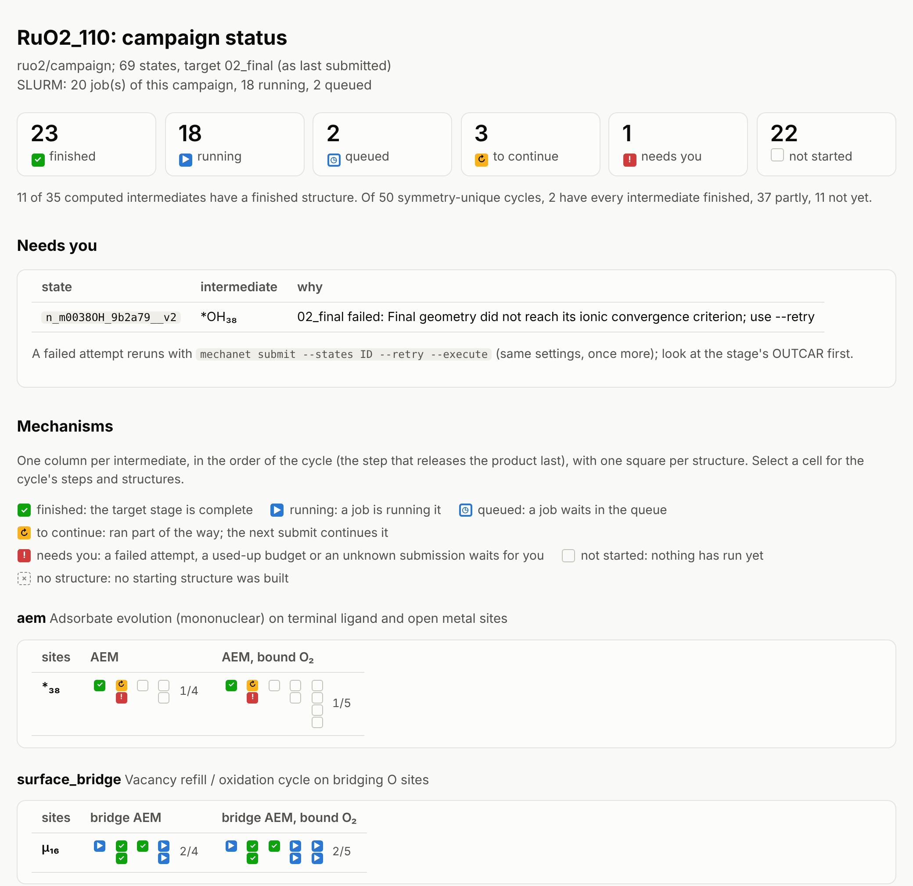

# Tutorial 3: Running on your cluster

You need four things on the cluster: mechanet in an environment the compute nodes can see, a job script that already runs VASP there, your licensed PAW library, and the project. From then on, the same few commands take the campaign from a pilot to frequencies, and repeating a command is always safe.

## 1. Install mechanet on the cluster

```bash
python3 -m venv ~/venvs/mechanet        # on a file system the compute nodes see
source ~/venvs/mechanet/bin/activate
pip install mechanet
```

Each job runs mechanet with the Python that ran `mechanet submit`, by its absolute path, so always submit from this environment. Copy the project folder over, or run `mechanet init` on the cluster.

To pre-screen with an ML potential on the cluster, put its model file in mechanet's models folder first, so that jobs need no internet: see [Model files on a cluster](../model-files.md).

## 2. Describe the cluster once

Start from a job script that already runs VASP on this cluster:

```bash
#!/bin/bash -l
#SBATCH --job-name=vasp
#SBATCH --nodes=1
#SBATCH --ntasks-per-node=64
#SBATCH --time=24:00:00
#SBATCH --partition=standard
#SBATCH --account=my_project
#SBATCH --mail-user=me@uni.example
#SBATCH --mail-type=END

module purge
module load intel/2023 intel-mpi vasp/6.4.2
export OMP_NUM_THREADS=1

srun vasp_std > vasp.out 2>&1
```

```bash
mechanet cluster import vasp_job.sh --name hpc
```

```text
wrote ~/.config/mechanet/clusters/hpc.yaml
  vasp:   srun vasp_std
  sbatch: nodes=1, ntasks-per-node=64, time=24:00:00, partition=standard, account=my_project
  setup:  3 line(s)
  note: line 15: left out '> vasp.out', '2>&1' of the VASP launch line (the runner writes vasp.out itself, ...)
  note: 3 line(s) were not copied (ignored_lines in the profile): #SBATCH --job-name  (set by mechanet for each job); #SBATCH --mail-user  (personal); #SBATCH --mail-type  (personal)
```

| In your script | In the profile |
|---|---|
| `#SBATCH` resources (nodes, tasks, time, partition, account, ...) | Kept |
| Job name, output files, mail, `--begin`, `--dependency` | Left out: mechanet sets its own or they belong to one submission |
| `module`, `source`, `export`, `conda` lines, plain assignments | Kept verbatim and in order |
| The VASP launch line | Becomes `vasp_command`, without redirections or a trailing `&` |
| The shell (`#!/bin/bash -l`) | Kept |

Now look at exactly what mechanet will submit:

```bash
mechanet cluster show hpc
```

It prints the full job script for one state, including `#SBATCH --signal=B:USR1@1800`: 30 minutes before the time limit mechanet tells VASP to stop cleanly, and the next job continues. A walltime too short for a stage is reported here. Open the profile in `~/.config/mechanet/clusters/hpc.yaml` to add two useful keys:

```yaml
potcar_dir: /path/to/potpaw_PBE     # your licensed PAW library
max_active_jobs: 20                 # never more than 20 of this campaign's jobs at once
```

## 3. Connect the project

Set `cluster: hpc` in project.yaml before `mechanet generate`. For a campaign that already exists, apply the profile instead, then assemble the POTCARs:

```bash
mechanet cluster use hpc
mechanet prepare --potcars
```

## 4. Compute the molecular references

The free energies need H2 and H2O (and Cl2 for CER) computed with your slab's functional, PAW datasets, cutoff and dispersion:

```bash
mechanet references --molecules refs --potcars
```

This writes `refs/H2` and `refs/H2O`, each with `relax/` and `freq/` inputs derived from your INCAR_final, with the functional, cutoff, dispersion and solvation overrides of `vasp:` in your project. For each molecule, run VASP in `relax/`, copy `relax/CONTCAR` to `freq/POSCAR`, and run VASP in `freq/` with your usual job script. Then:

```bash
mechanet references --collect refs
```

E0 and the ideal-gas free-energy correction go into `inputs/references.yaml`, with `protocol_id`, a description of how the molecules were computed, and the checks mechanet could make itself: every correction was computed at the analysis temperature, the water pressure is declared, and every molecule's functional, cutoff, dispersion and solvation tags and PAW datasets match your slab's. Run it in the project folder on the cluster, where the slab's PAW datasets are readable. A mismatch, or anything it could not compare, is printed as a warning and leaves that check unconfirmed. mechanet never substitutes literature values, and the analysis refuses incomplete references.

## 5. Run the pilot

```bash
mechanet submit --pilot             # preview
mechanet submit --pilot --execute   # submit
```

```text
preview: 8 state(s): 8 dry_run
state                           status   next stage  through
------------------------------  -------  ----------  -------
n_0016H2O_882d11__v1            dry_run  01_loose    final
n_0016OH_d3905d__v1             dry_run  01_loose    final
...
ref                             dry_run  01_loose    final
Preview only: add --execute to submit.
```

The pilot is the reference surface, one start per adsorbate type and the most crowded start. It tests your protocol on the cluster and measures timings. Jobs are named `mn_<state>`; each state folder holds `run.json`, one folder per stage and the job's `slurm-<id>.out`. When the pilot is done, `mechanet plan` adds a node-hour estimate for the whole campaign.

## 6. Run everything

```bash
mechanet submit --execute                                # every state through 02_final
mechanet submit --max-active 20 --refill --execute       # or: 20 jobs at a time, each finishing job submits the next
```

Repeat `mechanet submit --execute` whenever you like. Finished states are skipped, states with a live job are skipped, and states stopped by the walltime continue where they stopped. The summary table names what needs you:

| Status | Meaning | What to do |
|---|---|---|
| `submitted`, `dry_run` | Queued now, or would be | Nothing |
| `skipped_complete`, `skipped_active` | Done, or a job is pending or running | Nothing |
| `deferred` | Waits for a free slot under the job cap | Repeat later, or use `--refill` |
| `skipped_needs_retry` | VASP finished but the result failed a check | Look at the stage's `attempt.json`, then `--retry` |
| `skipped_exhausted`, `skipped_stalled` | The retry budget is used up, or the last job made no progress | Inspect the state folder |
| `skipped_submission_unknown` | sbatch did not answer clearly | Run the `mechanet resolve-submission ...` command it prints |

## 7. Follow the campaign

```bash
mechanet status
```

```text
RuO2_110: 69 states, target 02_final (as last submitted; 02_final where never submitted)
SLURM: 20 job(s) of this campaign (18 running, 2 queued)

  ✓ finished 23   ▶ running 18   ◷ queued 2
  ↻ to continue 3   ! needs you 1   ⋅ not started 22

Intermediates: 11 of 35 have a finished structure
Cycles (50 symmetry-unique): 2 with every intermediate finished, 37 partly, 11 not yet
  aem                          2 cycles: 0 complete, 2 partly, 0 not yet
  bifunctional                10 cycles: 0 complete, 5 partly, 5 not yet
  hydrated                    12 cycles: 2 complete, 6 partly, 4 not yet
  pair_coupling               12 cycles: 0 complete, 12 partly, 0 not yet
  surface_bridge               2 cycles: 0 complete, 2 partly, 0 not yet
  terminal_bridge_coupling    12 cycles: 0 complete, 10 partly, 2 not yet

Needs you:
  n_m0038OH_9b2a79__v2  02_final failed: Final geometry did not reach its ionic convergence criterion; use --retry

Jobs:
     5120428  RUNNING        2:00:41  n_0016OH_m0046O_845654__v1  *O₄₆ · μ-OH₁₆
     5120429  RUNNING        3:13:41  n_0016OH_m0046O_845654__v2  *O₄₆ · μ-OH₁₆
     5120430  RUNNING        4:26:41  n_0016OOH_6ccd66__v1  μ-OOH₁₆
     ...
```

`status` sorts every state into one group, measured against the stage it was submitted for: finished, running, queued, to continue (stopped part way; the next submit continues it), needs you, or not started. It reads the run records, the submission ledger and one `squeue` listing, and changes nothing. It also writes `campaign/status.html`; copy it to your computer and open it in a browser:



Each row of the grid is a site or a pair of sites, each column a mechanism, and each cell a cycle: one column of squares per intermediate, in the order of the cycle, with one square per starting structure. Select a cell for the cycle's steps and the status of each structure. `--cycles` prints the same marks in the terminal, and `--list todo` prints the IDs of the states a submit would start, for `--states @FILE`. [Following a campaign](../following-a-campaign.md) explains the page in detail, and <a href="../status-example.html">an example page</a> lets you try it.

## 8. Collect, select, frequencies

```bash
mechanet collect
mechanet select
mechanet submit --selected --through freq --execute
```

`collect` parses every finished run, checks convergence, forces and magnetic moments, and assigns each relaxed structure to the intermediate it became; `mechanet review` lists the finished structures it did not accept, with what changed ([Checking results](../checking-results.md)). `select` keeps the variants within 0.10 eV of each intermediate's lowest, at most two (`--max-per-node 1` keeps one per intermediate and cuts the frequency work). Variants that relaxed into the same minimum are counted once, and `--families aem` selects only for the cycles of the families you name. The last command runs the single point and the finite-displacement Hessian of the selected states; displacements are restartable units, so a job stopped by the walltime loses nothing.

## 9. Clean up

```bash
mechanet cleanup              # lists the WAVECAR and CHGCAR files no pending stage needs
mechanet cleanup --execute    # deletes them
```

**Next:** [tutorial 4](analysis.md) turns the results into free energies.
