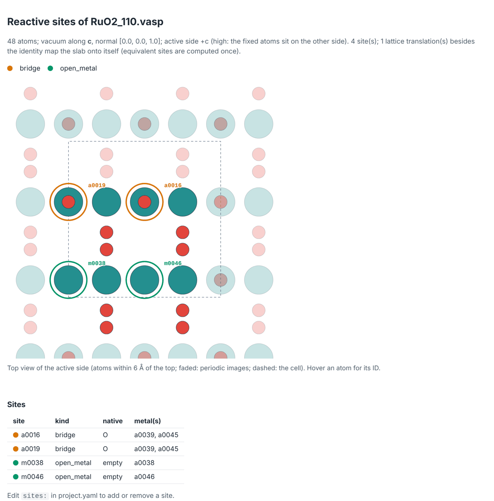

# Tutorial 1: Your first OER network

Without a cluster, you build the oxygen-evolution network of RuO2(110): 65 intermediates, 154 steps and 106 catalytic cycles, each intermediate with a starting structure ready for VASP. All you need is mechanet itself ([Getting started](../getting-started.md#install)).

## 1. Get an example slab

```bash
mkdir oer-tutorial && cd oer-tutorial
mechanet examples RuO2_110
```

This writes `RuO2_110.vasp`, a 2×1 RuO2(110) slab of 48 atoms. `mechanet examples` lists the other two: IrO2(110) and Pt(111).

## 2. Create the project

```bash
mechanet init RuO2_110.vasp ruo2
```

`init` reads the slab and reports what it found before it asks anything:

```text
RuO2_110.vasp: O32 Ru16 (48 atoms)
  vacuum along c (gap 16.6 A, high); normal [0.0, 0.0, 1.0]
  active side: +c [high: the fixed atoms sit on the other side]; thickness 12.016 A, 12 layers
  fixed region: 22 fixed / 26 movable atoms (from file)
  proposed reactive sites (4): 2x bridge O, 2x open_metal empty
       a0016  bridge     native O
       a0019  bridge     native O
       m0038  open_metal native empty on a0038
       m0046  open_metal native empty on a0046
```

Then it asks four questions. Press Enter to accept each proposal (the `*` choice, or the capital letter):

```text
  [ask] Use the 4 proposed reactive site(s)? [Y/n]
  [ask] Reaction
      1) cer: Chlorine evolution reaction
     *2) oer: Oxygen evolution reaction
  [ask] Mechanism scope
      1) aem: adsorbate evolution (*OH, *O, *OOH) on each terminal site and open metal [aem]
      2) aem+bifunctional: AEM plus proton transfer to a neighbouring acceptor site [aem, bifunctional]
     *3) core: every core family of the reaction (the curated literature set) [...]
      4) all: every registered family of the reaction, including the expensive ones [...]
  [ask] Partial-Hessian region: the 2 reactive ligand atoms and their H (every added atom is active too)? [Y/n]
```

The scope decides how many mechanisms, and so how many calculations, you get. The last question sets which atoms vibrate in the frequency calculations; [tutorial 2](own-slab.md#2-inspect-before-you-commit) explains it. `mechanet init ... --yes` accepts every proposal without asking.

| Written by `init` | What it is |
|---|---|
| `ruo2/project.yaml` | Every decision of the study, in one editable file |
| `ruo2/slab/site_map.html` | A picture of the sites, to check them |
| `ruo2/inputs/INCAR_loose`, `INCAR_final`, `KPOINTS` | DFT inputs from the `pbe-d3` preset; review them before production |
| `ruo2/inputs/references.yaml` | The template for the molecular references ([tutorial 3](cluster.md#4-compute-the-molecular-references)) |

## 3. Check the sites

Open `ruo2/slab/site_map.html` in a browser.



Orange rings mark the two bridging O (a0016, a0019). Green rings mark the two coordinatively unsaturated Ru (m0038, m0046), which start empty. Faded atoms are periodic images, the dashed line is the cell, and hovering an atom shows its ID.

## 4. Read the project file

`project.yaml` has a comment on every line. `[auto]` marks what `init` detected and you should check once; `[confirmed]` marks what you answered.

```yaml
sites:                            # [confirmed] reactive sites; delete an entry to exclude it
  - {id: a0016, kind: bridge, native: O}
  - {id: a0019, kind: bridge, native: O}
  - {id: m0038, kind: open_metal, native: empty, metal: a0038}
  - {id: m0046, kind: open_metal, native: empty, metal: a0046}

scope:
  families: [aem, surface_bridge, pair_coupling, terminal_bridge_coupling, bifunctional, hydrated, walden]  # [confirmed]
```

A misspelled key is refused with a suggestion (`ph`: did you mean `pH`?), so edits are safe to try.

## 5. Build the network

```bash
cd ruo2
mechanet generate
```

```text
  candidate nodes: 65
  computed nodes: 36
  symmetry equivalent nodes: 29
  unique initial structures: 66
  proposed edges: 154
  complete stoichiometric cycles: 106
  symmetry unique cycles: 53
  WARNING: No cluster profile in project.yaml: set `cluster:` and run ...
```

Of the 65 intermediates, 29 are lattice-translation images of others and inherit their energies, so 36 are computed. Some intermediates get more than one starting placement, which gives 66 starting structures; a second placement that a rotation or mirror of the slab would turn into the first is not written, because DFT would repeat the same calculation. The warning is expected until [tutorial 3](cluster.md).

Everything lands in `ruo2/campaign/`: `network.json` holds the intermediates, steps and cycles, and `states/` holds one folder per starting structure with its `POSCAR`.

## 6. See what it will cost

```bash
mechanet plan
```

```text
campaign (oer): 65 intermediates (36 computed, 29 symmetry images), 154 steps, 106 cycles (53 symmetry-unique)
  cycles by family: aem 4, bifunctional 20, hydrated 24, pair_coupling 24, surface_bridge 4, terminal_bridge_coupling 24, walden 6
  starting structures: 66
  stages: 01_loose -> 02_final -> 04_static -> 05_freq (frequency.central = final)
  relaxation_jobs (01_loose + 02_final): 66
  states_continuing_to_04_static_05_freq (estimate): 54
  frequency_displacements (estimate): 1524
  node-hours: unknown. No finished runs yet: submit the pilot ...
```

Every starting structure is relaxed with loose, then final settings. The best variants of each intermediate then get a single point and a partial Hessian by finite displacements, 1,524 single points here. Node-hours appear after the pilot of [tutorial 3](cluster.md#5-run-the-pilot). A smaller scope costs less: with `--scope aem` the same slab gives 9 intermediates (5 computed) and 9 starting structures.

## 7. Explore the cycles

```bash
mechanet cycles --unique
mechanet show-cycle aem_m0038_AEM
```

```text
aem_m0038_AEM: Adsorbate evolution (AEM)  [aem; oer]
  Proposed on this surface. Sources: Rossmeisl et al. 2005, 2007; Man et al. 2011; Dionigi et al. 2020; Shi et al. 2025
  sites: 38 = m0038: open site on Ru a0038 (bare)
  1. *₃₈ + H₂O → *OH₃₈ + H⁺ + e⁻     electrochemical
       ref -> n_m0038OH_9b2a79   [Refill the vacant site from water (or adsorb OH on a bare metal).]
  2. *OH₃₈ → *O₃₈ + H⁺ + e⁻          electrochemical
       n_m0038OH_9b2a79 -> n_m0038O_d0b786   [Paired proton/electron removal.]
  3. *O₃₈ + H₂O → *OOH₃₈ + H⁺ + e⁻   electrochemical
       n_m0038O_d0b786 -> n_m0038OOH_5560a2   [Water attack / hydroperoxo formation hypothesis.]
  4. *OOH₃₈ → *₃₈ + O₂ + H⁺ + e⁻     electrochemical
       n_m0038OOH_5560a2 -> ref   [O2 release with one PCET; path unverified.]
  symmetry-equivalent: aem_m0046_AEM
```

This is the textbook adsorbate-evolution mechanism on the open Ru, written as reaction equations with the step that releases O₂ last. `*₃₈` is the bare Ru of site m0038 (the subscript is the site number) and `*OH₃₈` the same Ru with OH; a step is electrochemical when an electron crosses the interface. Under each step are the IDs of its two intermediates and a note. Cycle IDs read family, site, variant. The other families add O–O coupling between neighbouring sites, proton transfer to a neighbour and water-assisted routes; `mechanet plugins` lists them all.

## 8. Find cycles nobody wrote down

```bash
mechanet pathways
```

```text
8002 cycles of up to 6 steps on 2 sites: 106 of 106 curated cycles recovered, 7896 discovered (3948 symmetry-unique), 176 steps proposed
```

mechanet proposes elementary steps between the intermediates and finds every balanced catalytic cycle among them. Without energies this is a census; [tutorial 4](analysis.md#5-rank-every-pathway-not-only-the-written-ones) ranks the cycles and finds the route of lowest overpotential.

**Next:** [tutorial 2](own-slab.md) to set up your own slab, or [tutorial 3](cluster.md) to run this one on a cluster.
