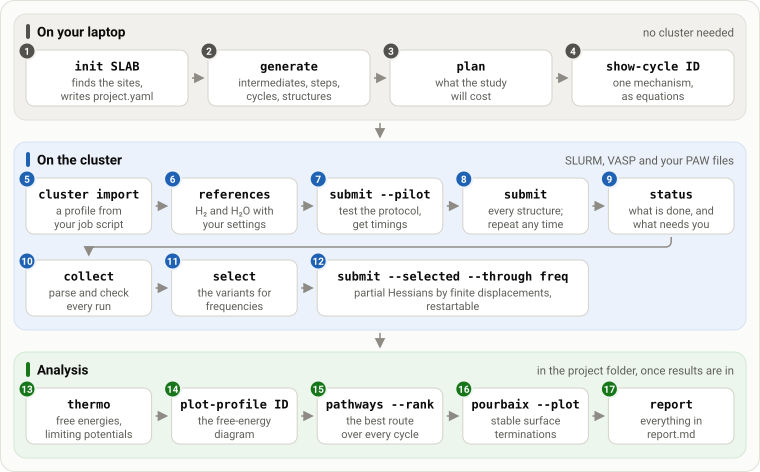

# Tutorials

Five tutorials take you from a slab file to free-energy diagrams, limiting potentials and
surface Pourbaix diagrams. Tutorials 1, 2 and 5 run on a laptop; 3 and 4 need a SLURM cluster
with VASP.

::::{grid} 1 1 2 2
:gutter: 3

:::{grid-item-card} 1. Your first OER network
:link: first-network
:link-type: doc

An example slab, `init`, the site map, `generate`, `plan`, and reading the cycles.
+++
Needs: a laptop
:::

:::{grid-item-card} 2. Bring your own slab
:link: own-slab
:link-type: doc

Building a slab, checking what `init` detected, fixing sites and regions, the scope and the
DFT inputs.
+++
Needs: a laptop
:::

:::{grid-item-card} 3. Running on your cluster
:link: cluster
:link-type: doc

A cluster profile from your job script, molecular references, the pilot, the full campaign,
following it, and the frequencies.
+++
Needs: SLURM, VASP and its PAW files
:::

:::{grid-item-card} 4. From energies to answers
:link: analysis
:link-type: doc

`thermo`, screening, free-energy profiles, magnetic moments, pathway ranking, Pourbaix
diagrams and the report.
+++
Needs: results from tutorial 3
:::

:::{grid-item-card} 5. Other reactions and your own mechanisms
:link: other-reactions
:link-type: doc

Chlorine evolution and its selectivity against OER, the HER plugin, and writing a mechanism
family.
+++
Needs: a laptop
:::
::::



Each box is one `mechanet` command, in the order you run it; only the middle band needs SLURM
and VASP.

## Before you start

- Python 3.10 or newer. Install with `pip install "mechanet[plots]"`; the `plots` extra adds
  matplotlib for figures. Until the first release is on PyPI, install it from the repository:
  `pip install "mechanet[plots] @ git+https://github.com/dhernandezcastillo/mechanet.git@v0.1.6"`.
- Every command prints a readable summary; add `--json` for scripts. `mechanet COMMAND --help`
  lists the options of a command, and the [command reference](../commands.md) lists them all.
- Nothing is ever submitted to SLURM without `--execute`. Every other command is safe to try.

## Example projects

The source archive (and the [repository](https://github.com/dhernandezcastillo/mechanet/tree/main/examples))
has ready-made projects in `examples/`; set `cluster:` in a `project.yaml` and run
`mechanet generate` in its folder.

| Folder | System | Reaction, scope |
|---|---|---|
| `examples/ruo2_110` | RuO2(110), 2×1, bridging O and CUS Ru | OER, core families |
| `examples/iro2_110` | IrO2(110), 2×1 | OER, core families |
| `examples/pt_111` | Pt(111), 3×3×4 | OER, adsorbate evolution |
| `examples/ruo2_110_cer` | RuO2(110) | CER, core families |
| `examples/nife_ldh` | NiFe LDH edge (90 atoms, skewed cell, interlayer water) | OER, the core families without `walden` (the family list of its reference build) |

The three slabs `RuO2_110`, `IrO2_110` and `Pt_111` also come with the package:
`mechanet examples NAME` writes one to start a project from. `examples/build_slabs.py`
rebuilds the oxide and metal slabs (pymatgen, ASE) from experimental lattice constants; relax
the bulk with your functional before production.

```{toctree}
:hidden:

first-network
own-slab
cluster
analysis
other-reactions
```
