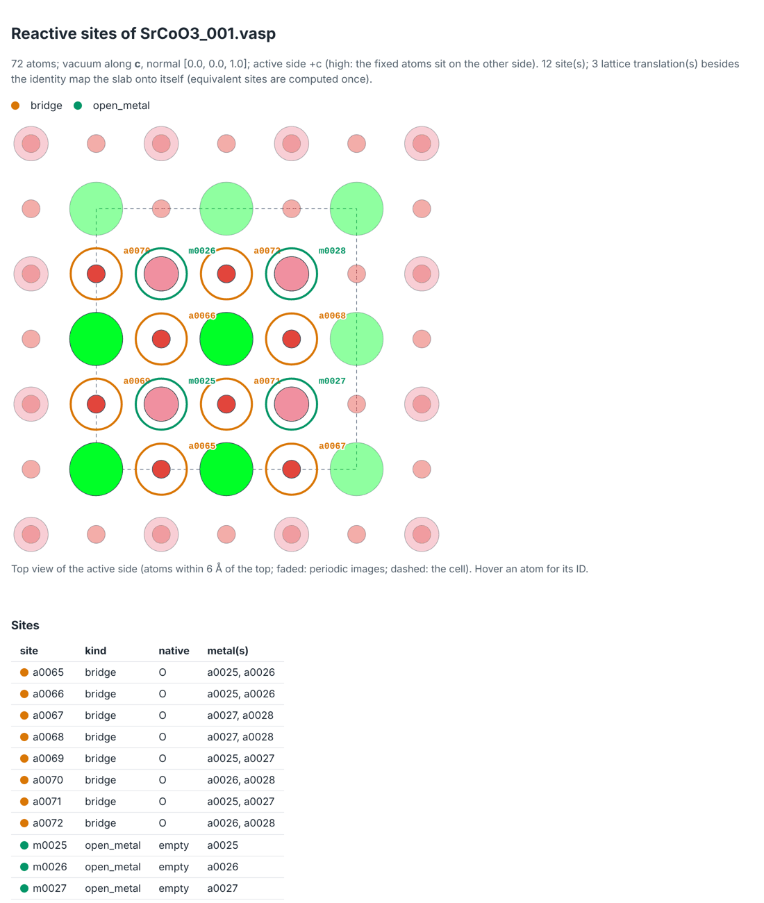

# Tutorial 2: Bring your own slab

mechanet takes any slab file that ASE reads. Here you build a perovskite slab, SrCoO3(001) with CoO2 on top, check what `init` detects, and learn how to correct it.

## 1. Build the slab

mechanet expects three things of a slab:

- vacuum along one lattice vector;
- fixed atoms (selective dynamics) on the side that is *not* active, so that the active side is unambiguous;
- each element in one block of the POSCAR, as VASP writes it.

This pymatgen script builds a 2×2 slab with CoO2 on both faces and fixes its lower half:

```python
# make_slab.py: SrCoO3(001), CoO2 on both faces, 2x2 in plane, lower half fixed
from pymatgen.core import Lattice, Structure
from pymatgen.core.surface import SlabGenerator
from pymatgen.io.vasp import Poscar

bulk = Structure(Lattice.cubic(3.829), ["Sr", "Co", "O", "O", "O"],
                 [[0, 0, 0], [0.5, 0.5, 0.5], [0.5, 0.5, 0], [0.5, 0, 0.5], [0, 0.5, 0.5]])
generator = SlabGenerator(bulk, (0, 0, 1), min_slab_size=12, min_vacuum_size=15, center_slab=True)
for slab in generator.get_slabs(symmetrize=True):
    z_top = max(site.coords[2] for site in slab)
    top_layer = {site.specie.symbol for site in slab if site.coords[2] > z_top - 0.5}
    if top_layer == {"Co", "O"} and slab.is_symmetric():
        break
slab.make_supercell([2, 2, 1])
z = [site.coords[2] for site in slab]
cut = min(z) + 0.45 * (max(z) - min(z))
slab = slab.get_sorted_structure()          # one block per element
z = [site.coords[2] for site in slab]
Poscar(slab, selective_dynamics=[[zi > cut] * 3 for zi in z]).write_file("SrCoO3_001.vasp")
print(slab.composition.formula, "-", len(slab), "atoms")
```

```text
Sr12 Co16 O44 - 72 atoms
```

Use a bulk relaxed with your own functional for production. `SlabGenerator.get_slabs()` lists every termination of a facet, which is how you pick the one you want.

## 2. Inspect before you commit

```bash
mechanet inspect SrCoO3_001.vasp --site-map srco_map.html
```

```text
SrCoO3_001.vasp: Sr12 Co16 O44 (72 atoms)
  vacuum along c (gap 19.14 A, high); normal [0.0, 0.0, 1.0]
  active side: +c [high: the fixed atoms sit on the other side]; thickness 11.487 A, 7 layers
  fixed region: 32 fixed / 40 movable atoms (from file)
  roles: ligand O; metal Co; spectator Sr
  proposed reactive sites (12): 8x bridge O, 4x open_metal empty
  symmetry: 3 lattice translation(s) within 0.005 A -> 3 unique site class(es)
  site pairs within 3.3 A: 32
```



The in-plane O between two Co are bridge sites and the five-coordinated Co are open metal sites. Sr is recognised as a spectator cation. The 2×2 cell repeats the 1×1 pattern, so the 12 sites fall into 3 classes, and each class is computed once.

| Line of the report | What it decides |
|---|---|
| vacuum, active side | Where adsorbates go; "low" confidence means `init` will ask you |
| fixed region | Atoms frozen in every relaxation (from the file, or a proposal of bottom layers) |
| roles | `metal`, `ligand`, `spectator` or `nonmetal` for each element |
| reactive sites | `terminal`, `bridge`, `mu3`, `framework` or `open_metal`, with the native occupant |
| symmetry, pairs | Equivalent sites computed once; neighbours within 3.3 Å for two-site mechanisms |

## 3. Create the project with a first scope

```bash
mechanet init SrCoO3_001.vasp srco --scope aem
cd srco
mechanet generate
```

For Co, `init` adds one question: `Use the Materials Project Hubbard U values for Co (U = 3.32 eV)? [Y/n]`. `generate` then reports 17 intermediates (5 computed), 10 starting structures and 8 cycles (2 symmetry-unique).

Start a new material with `aem`, then widen the scope once the first results are in:

| Scope | Families | Use it for |
|---|---|---|
| `aem` | `aem`: \*OH, \*O, \*OOH on terminal ligands and open metals | A first look at a new material |
| `aem+bifunctional` | adds proton transfer to a neighbouring acceptor | Oxides with a basic O next to the active metal |
| `core` | `aem`, `surface_bridge`, `pair_coupling`, `terminal_bridge_coupling`, `bifunctional`, `hydrated` | A full study of the literature mechanisms |
| `all` | `core` plus `oo_oo` (O4 recombination) | Completeness |
| a list | e.g. `--scope aem,bifunctional`, or `scope.families` in project.yaml | Your own selection |

## 4. Correct what was detected

Every decision lives in `project.yaml`. Edit it, then build again into a fresh folder: a campaign is never overwritten, so delete `campaign/` or pass `mechanet generate --out NEW_FOLDER`.

| To | Edit in project.yaml | Example |
|---|---|---|
| Drop a site | delete its entry under `sites:` |  |
| Add a ligand site | a new entry; atom IDs come from the site map (hover) | `- {id: a0123, kind: terminal, native: OH}` |
| Add a metal site the inspector cannot see | an `open_metal` entry with its metal and, if needed, a direction | `- {id: m0045, kind: open_metal, native: empty, metal: a0045, direction: [0, 0, 1]}` |
| Flip the active side | `slab.surface_sign` | `surface_sign: -1` |
| Re-label an element | `slab.roles` | `roles: {Mg: spectator, La: metal}` |
| Choose fixed atoms | `slab.fixed` | `{source: file}` or `{fixed_ids: [a0001, a0002]}` |
| Choose the vibrating atoms | `slab.frequency_atoms`, or a mask POSCAR | `frequency_mask: slab/MASK.vasp` |

An atom ID `a0045` is the 45th atom of the slab file. An `open_metal` entry adds a metal site the inspector did not propose, or points one in another direction. A single-atom catalyst such as Fe in N-doped graphene needs no such entry: the inspector proposes the open site on the Fe, whose axial position is free.

## 5. Choose the DFT inputs

`init` writes `inputs/INCAR_loose` and `inputs/INCAR_final` from the `pbe-d3` preset (PBE, D3(BJ), 500 eV, spin-polarised, dipole correction) and a Γ-centred `KPOINTS` mesh at 0.25 Å⁻¹ spacing (4×4×1 here). Review them before production.

- Your own protocol: `mechanet init slab.vasp proj --incar-loose INCAR_loose --incar-final INCAR_final --kpoints KPOINTS`. Give both INCARs; their LDAU and MAGMOM tags are used as written.
- +U: proposed from the Materials Project for oxides and fluorides; set or remove it in `vasp.dft_u`, or give your values to `init` at the start: `mechanet init SrCoO3_001.vasp srco --dft-u Co=3.32` (`--dft-u none` for no +U).
- Starting moments: `vasp.magmom_by_element` (high-spin by default).
- PAW datasets: `vasp.potcar_variants`, or `--potcar-variants Co=Co_pv` at `init`; the library itself is set per cluster ([tutorial 3](cluster.md#2-describe-the-cluster-once)), or per project with `--potcar-dir`.
- Parallelisation and per-stage tags: `vasp.common_overrides: {NCORE: 16, KPAR: 2}` and `vasp.stage_overrides: {01_loose: {NSW: 80}}`.

mechanet sets ISTART, ICHARG, LWAVE, LCHARG and LMAXMIX itself for each stage.

**Next:** [tutorial 3](cluster.md) runs the calculations on your cluster.
